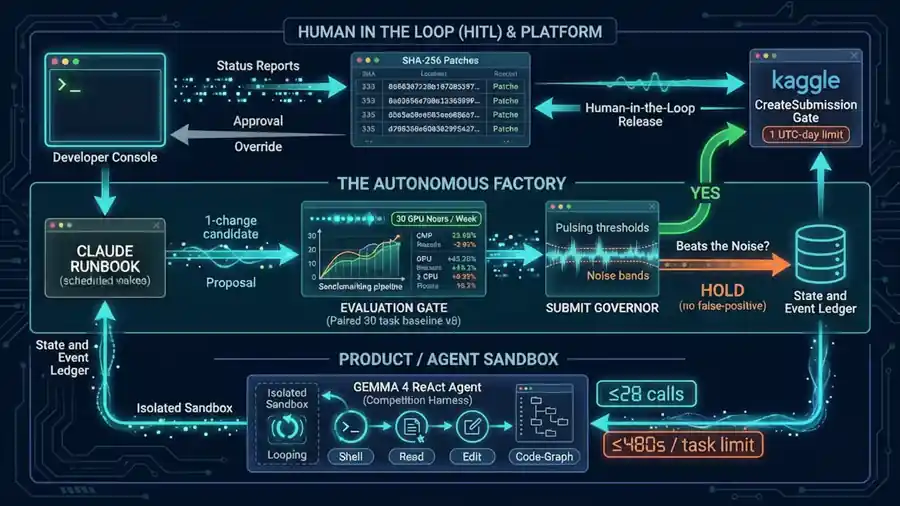

# NoiseGate Gemma 4 Factory

[](https://github.com/khaosans/noisegate-gemma4-factory/releases)
[](LICENSE)

An autonomous **build → evaluate → submit** loop that separates real agent improvements from benchmark noise.

**Version `1.0.0-beta.1`** (Capstone beta — not GA) · **Souriya Khaosanga · Adil Shamim** · CMU SCS Agentic AI · Fall 2026 · Kaggle [*Gemma 4 Developer Agent*](https://www.kaggle.com/competitions/gemma-4-developer-agent)

The public notebook that shows **0.22** on the board scored **0.17** when we submitted the same artifact. Locally, baseline **V8** solves **8, then 6, then 8** in-budget on the same 30 tasks. Kaggle allows **one CreateSubmission per UTC day**; NoiseGate still spends ~**30 GPU hours**/week of quota, so trusting a single screen without bars spends the budget promoting luck.

> **Success:** ship a better agent only when evidence beats measured noise, at a known cost.  
> **Out of scope:** fine-tuning Gemma; changing the competition harness.

| | |
|---|---|
| Best public (base) | **0.18** (V8) |
| V8 noise band (n=3) | mean **7.33** / 30 · ~**±2.5** tasks |
| Telemetry (N=390) | first edit @ call **16/28** · **62.3%** out-of-budget |
| Deadline | **2026-12-02** 23:59 UTC |

**Score SoT:** this repo’s factory base is **V8 @ 0.18**. Sibling climb tip packaging in [`cmu-agentic-ai`](https://github.com/khaosans/cmu-agentic-ai) keeps its own `docs/scoreboard.json` (may show a different tip best, e.g. **0.10**) — do not conflate the two. Climb bridge is read-only.

**Explore:** [Wiki](https://github.com/khaosans/noisegate-gemma4-factory/wiki/Home) · [Method card](https://github.com/khaosans/noisegate-gemma4-factory/wiki/Method-Card) · [Ops Console docs](https://github.com/khaosans/noisegate-gemma4-factory/wiki/Ops-Console) · [Architecture](https://github.com/khaosans/noisegate-gemma4-factory/wiki/Architecture) · [Video](https://youtu.be/-EiKv_MafOY) · [Ops Console artifact](https://claude.ai/artifact/6R7YzcGjHzh3U6dreF9YsW)

## Architecture

Factory above product: Claude proposes **one** SHA-256 delta; Gemma 4 ReAct runs the gate under **≤28 calls** / **≤480s**; humans alone own CreateSubmission (**1 / UTC day**). Consoles never submit.

<p align="center">
  
</p>

1. **Propose** — Claude runbook ships one delta + SHA-256 candidate.
2. **Sandbox** — Gemma 4 ReAct on the paired 30-task gate (**≤28 calls** / **≤480s**).
3. **Govern** — Submit Governor noise-vs-signal (V8 band **7.33 ± 2.5**); HOLD on in-band luck.
4. **HITL** — Human CreateSubmission only (**1 / UTC day**) after [Submit-Policy](https://github.com/khaosans/noisegate-gemma4-factory/wiki/Submit-Policy) bars pass.
5. **Ledger** — State & event ledger records the wake; loop resets for the next job.

Muted WebP · [MP4 fallback](assets/noisegate-architecture.mp4). Mermaid bands, product-vs-factory table, cadence v1→v2, and policy-vs-runtimes: [Architecture wiki](https://github.com/khaosans/noisegate-gemma4-factory/wiki/Architecture).

## How we ran it

Production climb = **Claude Project + scheduled wakes**. Demo / ops narrative = **Claude Ops Console** artifact.

1. Cowork loads `factory/project-instructions.md`, the runbook, and `results/eval-results.md` each wake.
2. Skills in [`factory/skills/`](factory/skills/): `build-candidate` → `run-eval-gate` → `weekly-decision` → `record-score`. State/ledger schemas: [`factory/state-and-artifacts.md`](factory/state-and-artifacts.md).
3. **Cadence (UTC):** Sat/Sun/Mon = work skeleton. **Submit law:** 1 / UTC day + [Submit-Policy](https://github.com/khaosans/noisegate-gemma4-factory/wiki/Submit-Policy). **Loop v2** (since 2026-11-20): event-driven jobs, KEPT14, z-gate, wake ledger — [Architecture](https://github.com/khaosans/noisegate-gemma4-factory/wiki/Architecture).
4. Kaggle login UI (notebook commit, gate start, CreateSubmission) stays on Claude’s authenticated session.

**Main demo UI:** [Ops Console artifact](https://claude.ai/artifact/6R7YzcGjHzh3U6dreF9YsW) · [Ops Console docs](https://github.com/khaosans/noisegate-gemma4-factory/wiki/Ops-Console) · [Claude Cowork Loop wiki](https://github.com/khaosans/noisegate-gemma4-factory/wiki/Claude-Cowork-Loop)

## Results that matter for shipping

Gate through mid-November 2026 — not a live leaderboard scrape.

| Version | Change | In-budget / 30 | Public LB | Gate |
|---|---|---|---|---|
| V8 | Baseline | 8, 6, 8 (mean 7.33) | **0.18** | Baseline |
| V11 | Reasoning / edit-deadline | 10 | 0.15 | Below single-run bar |
| V15 | Public 0.22 notebook copy | 7, 10 | 0.17 | Noise calibration |
| V18 | Heredoc recovery | 7, 7 | — | HOLD |
| V20 | Batched recon | 7 | 0.13 | HOLD (submitted by user override) |
| V21 | Think 1k → 2k | 6 | — | HOLD |
| V22 | Best-guess on empty diff | 9 | — | CONFIRM — 2nd paired run (J1) Sat 11-21 |
| V23 | Graph tools removed | 7 | — | HOLD |
| V24 | Tool-layer read-budget cap | — | — | Queued (next one-change hypothesis) |

*Insight — why paired gate + HOLD.* V11 looked like a win locally and lost on the board; V15 proved the board itself is noisy. Eleven candidates tested, zero false-positive ships. The harness’s job is refusing luck, not predicting every LB point. Telemetry (N=390): median first edit at call 16/28 and 62% overruns → the bottleneck is a long read loop; prompt-only deadlines failed (V17), so the next lever is a **tool-layer** call cap. More: [Architecture wiki](https://github.com/khaosans/noisegate-gemma4-factory/wiki/Architecture) · [`results/`](results/).

## Requirements map

[`CONCEPTS.md`](CONCEPTS.md) · [`docs/safety-plan.md`](docs/safety-plan.md) · [Requirements Compliance wiki](https://github.com/khaosans/noisegate-gemma4-factory/wiki/Requirements-Compliance)

Graded ship path = **ADK agent zip**. LangGraph `supervisor/` is course evidence only — not in the competition submission. Why three runtimes share one policy layer: [Architecture — Policy vs. Agent Runtimes](https://github.com/khaosans/noisegate-gemma4-factory/wiki/Architecture#policy-vs-agent-runtimes-why-this-stack).

## Repository map

| Path | What it is |
|---|---|
| [`product/`](product/) | Agent configs, candidates, zip builder |
| [`harness/`](harness/) | Trajectory parse, evaluators, decision rule |
| [`factory/`](factory/) | Runbook, Project instructions, Skills |
| [`factory_console/`](factory_console/) | Legacy local console (not used for demos; main UI = Claude Ops Console) |
| [`supervisor/`](supervisor/) · [`guardrails/`](guardrails/) · [`agentops/`](agentops/) | Course slice (not in Kaggle zip) |
| [`evals/`](evals/) · [`results/`](results/) | Safety cases · gate / LB bookkeeping |
| [Wiki](https://github.com/khaosans/noisegate-gemma4-factory/wiki/Home) · [`docs/wiki/`](docs/wiki/) | Preferred viewer · editor SoT |
| [`GOALS.md`](GOALS.md) · [`CONCEPTS.md`](CONCEPTS.md) · [`docs/decisions/`](docs/decisions/) | OKRs · concept map · ADRs |

## Quick start

```bash
pip install -r requirements.txt
pytest -q
python -m evals.safety.run
python product/build_submission.py
# Demo UI: https://claude.ai/artifact/6R7YzcGjHzh3U6dreF9YsW  (see wiki Ops-Console)
```

```python
from harness.trajectory import parse_log
from harness.decision_rule import RunSummary, V8_HISTORY, decide, paired_net

rows = parse_log(open("gate_output.txt"))
cand = [r for r in rows if r.candidate == "C1"]
v8 = [r for r in rows if r.candidate == "V8"]
print(decide([RunSummary.from_results(cand)], V8_HISTORY + [RunSummary.from_results(v8)],
             run_b_paired_net=paired_net(cand, v8),
             zip_sha_ok=True, one_change_off_base=True, never_scored=True))
```

## Future work

**P0** confirm V22 (second KEPT14 pair). **P1** screen **V24** tool-layer read-budget cap (hypothesis — not shipped; V17 prompt-only failed). Keep CreateSubmission HITL. Priority map: [Future Work wiki](https://github.com/khaosans/noisegate-gemma4-factory/wiki/Future-Work).

## What is not in this repo

Competition data/tasks, model weights, GPU wheelhouse, Kaggle credentials, other teams’ code. V15 credited, not copied: [flexonafft, *Budget-Aware Coding Agent v2*](https://www.kaggle.com/code/flexonafft/gemma-4-budget-aware-coding-agent-v2).

## References

1. Jimenez et al., *SWE-bench: Can Language Models Resolve Real-World GitHub Issues?* (ICLR 2024).  
2. Yao et al., *ReAct: Synergizing Reasoning and Acting in Language Models* (ICLR 2023).  
3. Kaggle & Google DeepMind, *Gemma 4 Developer Agent* competition harness (2026) — fixed model, 28 tool calls, 480s/task.

**Thesis vs related work:** like SWE-bench agents we optimize under a fixed harness; unlike “generate more cleverly,” NoiseGate’s contribution is an **eval-over-generator** factory — paired gates and HOLD so luck cannot burn the weekly submit. Method card: [wiki/Method-Card](https://github.com/khaosans/noisegate-gemma4-factory/wiki/Method-Card).

## License

MIT. See [`LICENSE`](LICENSE). See also [`SECURITY.md`](SECURITY.md).
