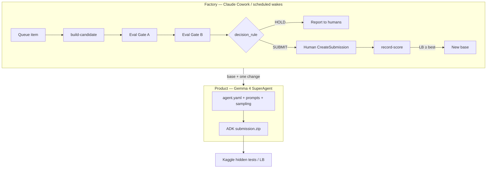

# NoiseGate — A Software Factory for a Gemma 4 Coding Agent

**Souriya Khaosanga · Adil Shamim** · CMU SCS Agentic AI (Fall 2026) · Kaggle *Google DeepMind Gemma 4 Developer Agent*

We built **two systems**:

- **Product** — a Gemma 4 ADK coding agent (`submission.zip`) that fixes real GitHub issues under Kaggle's call/time budget.
- **Factory** — a Claude-run climb loop that proposes one change, gates it, and may ship. Humans approve CreateSubmission on Kaggle; the Streamlit console never submits.

Main finding: in a self-improving system, the evaluation harness matters more than the generator. Most of the differences we measured were noise, and the factory's most useful act was refusing to ship.

| | |
|---|---|
| Best public score | **0.18** (V8, current base) |
| Versions evaluated / held by our gate | 7 / 3 (V14, V16, V17) |
| Measured noise | ±2–3 tasks per 30 locally · ±0.05 on the leaderboard |
| Competition deadline | **2026-12-02** 23:59 UTC |

**Class wiki** (demo story, Mermaid architecture, requirements map): [GitHub Wiki](https://github.com/khaosans/noisegate-gemma4-factory/wiki) — preferred viewer. In-repo source of truth: [`docs/wiki/`](docs/wiki/).

## The challenge

A Gemma 4 agent (`gemma-4-31b-it`, fixed by the rules) gets a repository (fastapi, requests, rich, …)
and an issue, and must produce a patch within **28 tool calls and ~8 minutes**. Hidden tests score
the patch. Kaggle allows one submission per UTC day; scoring takes ~1.5 days.

## Two systems



Humans decide base config, cadence, and final two selections. Detail: [`docs/wiki/Architecture.md`](docs/wiki/Architecture.md).

| | Product | Factory |
|---|---|---|
| Model | `gemma-4-31b-it` (competition-fixed) | Claude (Cowork / Project) |
| Job | Fix issues under the call/time budget | Propose one change, gate it, maybe ship |
| Memory | Context window only | `results/` + Skills |
| Submit path | ADK `submission.zip` on Kaggle | Humans approve; ≤1 gated submit / week |

## How we ran it (primary loop)

The production climb path is **Claude Project + scheduled wakes**, not the Streamlit console.

1. **Claude Cowork / Project** loads `factory/project-instructions.md`, the runbook, and `results/eval-results.md` on every wake.
2. **Skills** in [`factory/skills/`](factory/skills/) are the agentic procedures: `build-candidate` → `run-eval-gate` → `weekly-decision` → `record-score`.
3. **Cadence (UTC):** Sat build + Gate Run A · Sun Gate Run B · Mon decide + optional submit · other wakes status-only.
4. Login-heavy Kaggle UI (notebook commit, gate start, CreateSubmission) stays on Claude because that is where the authenticated browser session lives.

Cowork project artifact (external): [claude.ai/artifact/1Ldx2khByugozsHH5cuLfa](https://claude.ai/artifact/1Ldx2khByugozsHH5cuLfa). In-repo detail: [`docs/wiki/Claude-Cowork-Loop.md`](docs/wiki/Claude-Cowork-Loop.md).

## Local path (query / demo without Claude login)

For class demos and local operator queries we use:

- **Streamlit factory console** at **`:8765`** — [`factory_console/`](factory_console/), see [`docs/factory-console.md`](docs/factory-console.md)
- **Ollama** (optional chat backend) — OpenAI-compatible tools over the same `factory_console/actions.py` handlers
- **Offline mode** — keyword router when no live LLM is available

```bash
pip install -r requirements-console.txt -r requirements-agent.txt
streamlit run factory_console/app.py --server.port 8765
# open http://127.0.0.1:8765
```

The console may query records, replay the decision rule, run pytest / safety eval / zip build, and
(optionally) one supervised agent session. It **must not** start a Kaggle gate run, CreateSubmission,
or change the base config. Writes via `record_score` wait for an **Approve** click.

On the Mac demo host, a LaunchAgent (`com.noisegate.factory-console`) can KeepAlive the app on `:8765`.
Ollama chat (`FACTORY_CONSOLE_BACKEND`) and the climb/Kaggle read-only bridge (`CMU_AGENTIC_AI_ROOT`) are on `main` (#3, #4).

More: [`docs/wiki/Local-And-Streamlit.md`](docs/wiki/Local-And-Streamlit.md).

## Requirements map

Course concepts → code: [`CONCEPTS.md`](CONCEPTS.md). Safety commitments → tests: [`docs/safety-plan.md`](docs/safety-plan.md).
HITL and competition constraints summarized for graders: [`docs/wiki/Requirements-Compliance.md`](docs/wiki/Requirements-Compliance.md).

Graded Kaggle ship path remains the **ADK agent zip**. The LangGraph supervisor in `supervisor/` is
course evidence (guardrails, budgets, escalate) and is **not** inside the competition submission.

## Repository map

| Path | What it is |
|---|---|
| [`product/`](product/) | Submitted agent config, build script, and every candidate's one change |
| [`harness/`](harness/) | Trajectory parser, evaluators E1–E9, SUBMIT/HOLD decision rule (tested) |
| [`harness/eval-gate/`](harness/eval-gate/) | Kaggle evaluation notebook and environment notes |
| [`supervisor/`](supervisor/) | LangGraph supervisor (course slice; not in the Kaggle zip) |
| [`guardrails/`](guardrails/) | Tool policy, budgets, patch checks, untrusted-text handling |
| [`agentops/`](agentops/) | JSONL run logs, safety-plan metrics, query CLI |
| [`factory_console/`](factory_console/) | Streamlit demo + operator chatbot ([docs](docs/factory-console.md)) |
| [`factory/`](factory/) | Runbook, Project instructions, four Claude Skills |
| [`evals/`](evals/) | Fixture repo + adversarial cases G6–G17 |
| [`results/`](results/) | Gate runs, leaderboard scores, calibration log |
| [GitHub Wiki](https://github.com/khaosans/noisegate-gemma4-factory/wiki) · [`docs/wiki/`](docs/wiki/) | Class demo wiki (GitHub Wiki preferred; docs/wiki SoT) |
| [`docs/decisions/`](docs/decisions/) | Decision records |
| [`GOALS.md`](GOALS.md) · [`CONCEPTS.md`](CONCEPTS.md) | OKRs · concept → code map |

## Results

| Version | Change | Local in-budget solves /30 | Public score |
|---|---|---|---|
| V8 | base | 8, 6 | **0.18** |
| V11 | thinking budget cut | 10 | 0.15 |
| V12 | variant of V11 | 8 | 0.15 |
| V14 | + "run the issue example" | 6 → held | — |
| V15 | public 0.22 notebook, credited | 7, 10 | 0.17 |
| V16 | V15 − unused graph tools | 6 → held | — |
| V17 | V15 + "edit by call 20" rule | 7 → held | — |

Full tables: [`results/`](results/). Lessons: [`docs/lessons.md`](docs/lessons.md).

## Quick start

```bash
pip install -r requirements.txt
pytest -q                                  # decision rule, parser, guardrails, supervisor, safety eval
python -m evals.safety.run                 # adversarial cases: block rate + false positives
python -m agentops metrics                 # metrics over runs/ (see docs/agentops.md)
python product/build_submission.py         # rebuild submission.zip, print SHA-256s

pip install -r requirements-console.txt -r requirements-agent.txt
# Optional local LLM: ollama serve && ollama pull llama3.2:3b
# FACTORY_CONSOLE_BACKEND=ollama OLLAMA_HOST=http://127.0.0.1:11434 OLLAMA_MODEL=llama3.2:3b
streamlit run factory_console/app.py --server.port 8765
```

See [`docs/factory-console.md`](docs/factory-console.md) for Claude / Ollama / offline backend selection.

Parse an Eval Gate log and apply the rule:

```python
from harness.trajectory import parse_log
from harness.decision_rule import RunSummary, V8_HISTORY, decide, paired_net

rows = parse_log(open("gate_output.txt"))
cand = [r for r in rows if r.candidate == "C1"]
v8 = [r for r in rows if r.candidate == "V8"]
print(decide([RunSummary.from_results(cand)], V8_HISTORY + [RunSummary.from_results(v8)],
             run_b_paired_net=paired_net(cand, v8),
             zip_sha_ok=True, one_change_off_base=True, never_scored=True))
```

## Console backends (merged)

| PR | Status | What it adds |
|---|---|---|
| [#3](https://github.com/khaosans/noisegate-gemma4-factory/pull/3) | Merged | Local Ollama OpenAI-compatible chat backend (`FACTORY_CONSOLE_BACKEND`) |
| [#4](https://github.com/khaosans/noisegate-gemma4-factory/pull/4) | Merged | Read-only climb/Kaggle scoreboard bridge (`CMU_AGENTIC_AI_ROOT`); no CreateSubmission |

## Future work

- Keep submit HITL; use Ollama + climb bridge for local query only.
- Propose `record_score` from COMPLETE Kaggle rows (Approve still required).
- Frugal local Gemma supervisor demos (sandbox-required), separate from the Kaggle zip.
- Calibration: more decisive gate↔leaderboard points; re-measure noise.
- Optional course fallback evidence pack (traces + one guardrail + 3–5 golden cases) if needed.

Longer rationale: [`docs/wiki/Future-Work.md`](docs/wiki/Future-Work.md).

## What is not in this repo

Competition data and tasks, model weights, the GPU wheelhouse, Kaggle credentials, and other
teams' code. V15 is described and credited, not copied:
[flexonafft, *Budget-Aware Coding Agent v2*](https://www.kaggle.com/code/flexonafft/gemma-4-budget-aware-coding-agent-v2).

## License

MIT. See [`LICENSE`](LICENSE).
