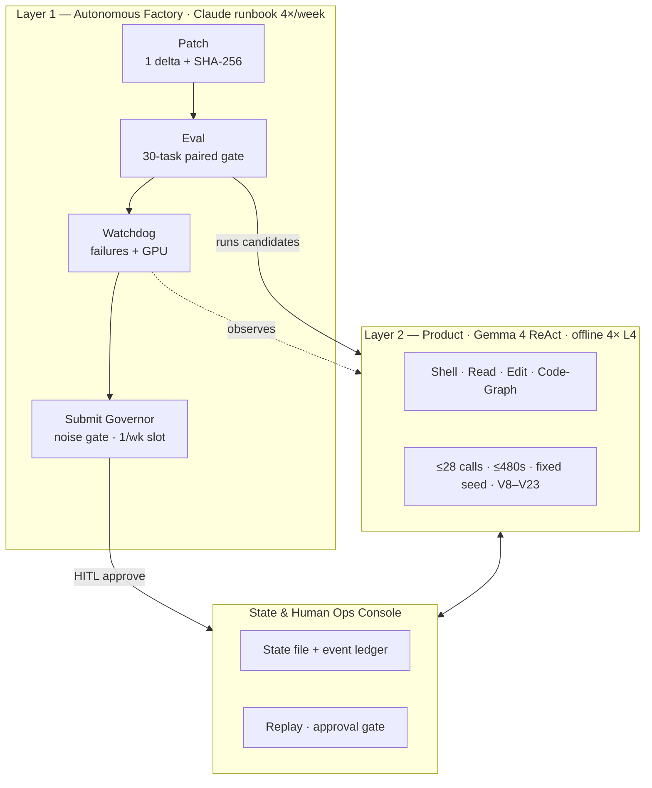

# NoiseGate Gemma 4 Factory

An autonomous **build → evaluate → submit** loop that separates real agent improvements from benchmark noise.

**Souriya Khaosanga · Adil Shamim** · CMU SCS Agentic AI · Fall 2026 · Kaggle [*Gemma 4 Developer Agent*](https://www.kaggle.com/competitions/gemma-4-developer-agent)

The public notebook that shows **0.22** on the board scored **0.17** when we submitted the same artifact. Locally, baseline **V8** solves **8, then 6, then 8** in-budget on the same 30 tasks. With **one planned Kaggle submission per week** and ~**30 GPU hours** of quota, trusting a single score spends the budget promoting luck.

> **Success:** ship a better agent only when evidence beats measured noise, at a known cost.  
> **Out of scope:** fine-tuning Gemma; changing the competition harness.

| | |
|---|---|
| Best public (base) | **0.18** (V8) |
| V8 noise band (n=3) | mean **7.33** / 30 · ~**±2.5** tasks |
| Telemetry (N=390) | first edit @ call **16/28** · **62.3%** out-of-budget |
| Deadline | **2026-12-02** 23:59 UTC |

**Explore:** [Wiki](https://github.com/khaosans/noisegate-gemma4-factory/wiki/Home) · [Architecture](https://github.com/khaosans/noisegate-gemma4-factory/wiki/Architecture) · [Video](https://youtu.be/-EiKv_MafOY) · [Ops Console](https://claude.ai/artifact/6R7YzcGjHzh3U6dreF9YsW)

## Architecture

The product is a Gemma 4 ReAct coding agent under Kaggle’s call/time caps (issue-fixing tasks in the SWE-bench spirit; competition harness fixed). The factory is a scheduled Claude runbook that proposes **one** delta, gates it, and spends the weekly submit slot only when the gain clears measured noise. Humans own CreateSubmission — consoles never do.



*Insight — noise vs luck.* Eval and Submit Governor sit above the product so a lucky single run cannot burn the weekly slot. The Ops Console replays the ledger and gates costly actions; it never CreateSubmission. Full story + telemetry: [Architecture wiki](https://github.com/khaosans/noisegate-gemma4-factory/wiki/Architecture).

| | Product | Factory |
|---|---|---|
| Model | `gemma-4-31b-it` (competition-fixed) | Claude (scheduled runbook / Project) |
| Job | Fix issues under call/time budget | One delta → gate → maybe ship |
| Memory | Context window only | State file + append-only ledger + `results/` |
| Submit path | ADK `submission.zip` on Kaggle | Humans approve; ≤1 gated submit / week |

## How we ran it

Production climb = **Claude Project + scheduled wakes**, not Streamlit.

1. Cowork loads `factory/project-instructions.md`, the runbook, and `results/eval-results.md` each wake.
2. Skills in [`factory/skills/`](factory/skills/): `build-candidate` → `run-eval-gate` → `weekly-decision` → `record-score`.
3. **Cadence (UTC):** Sat build + Gate A · Sun Gate B · Mon decide + optional submit · other wakes status-only.
4. Kaggle login UI (notebook commit, gate start, CreateSubmission) stays on Claude’s authenticated session.

[Ops Console](https://claude.ai/artifact/6R7YzcGjHzh3U6dreF9YsW) · [Claude Cowork Loop wiki](https://github.com/khaosans/noisegate-gemma4-factory/wiki/Claude-Cowork-Loop)

## Local demo (`:8765`)

```bash
pip install -r requirements-console.txt -r requirements-agent.txt
streamlit run factory_console/app.py --server.port 8765
```

Query / replay / pytest / zip build are fine. **Must not:** gate-start, CreateSubmission, or change base config. `record_score` writes need an **Approve** click. Details: [Local and Streamlit wiki](https://github.com/khaosans/noisegate-gemma4-factory/wiki/Local-And-Streamlit) · [`docs/factory-console.md`](docs/factory-console.md).

## Results that matter for shipping

Gate through mid-November 2026 — not a live leaderboard scrape.

| Version | Change | In-budget / 30 | Public LB | Gate |
|---|---|---|---|---|
| V8 | Baseline | 8, 6, 8 (mean 7.33) | **0.18** | Baseline |
| V11 | Reasoning / edit-deadline | 10 | 0.15 | Below single-run bar |
| V15 | Public 0.22 notebook copy | 7, 10 | 0.17 | Noise calibration |
| V18 | Heredoc recovery | 7, 7 | — | HOLD |
| V21 | Think 1k → 2k | 6 | — | HOLD |
| V22 | Best-guess on empty diff | 9 | — | HOLD (needs 2nd run) |

*Insight — why paired gate + HOLD.* V11 looked like a win locally and lost on the board; V15 proved the board itself is noisy. Eleven candidates tested, zero false-positive ships. The harness’s job is refusing luck, not predicting every LB point. Telemetry (N=390): median first edit at call 16/28 and 62% overruns → the bottleneck is a long read loop; prompt-only deadlines failed (V17), so the next lever is a **tool-layer** call cap. More: [Architecture wiki](https://github.com/khaosans/noisegate-gemma4-factory/wiki/Architecture) · [`results/`](results/).

## Requirements map

[`CONCEPTS.md`](CONCEPTS.md) · [`docs/safety-plan.md`](docs/safety-plan.md) · [Requirements Compliance wiki](https://github.com/khaosans/noisegate-gemma4-factory/wiki/Requirements-Compliance)

Graded ship path = **ADK agent zip**. LangGraph `supervisor/` is course evidence only — not in the competition submission.

## Repository map

| Path | What it is |
|---|---|
| [`product/`](product/) | Agent configs, candidates, zip builder |
| [`harness/`](harness/) | Trajectory parse, evaluators, decision rule |
| [`factory/`](factory/) | Runbook, Project instructions, Skills |
| [`factory_console/`](factory_console/) | Streamlit demo / operator chat |
| [`supervisor/`](supervisor/) · [`guardrails/`](guardrails/) · [`agentops/`](agentops/) | Course slice (not in Kaggle zip) |
| [`evals/`](evals/) · [`results/`](results/) | Safety cases · gate / LB bookkeeping |
| [Wiki](https://github.com/khaosans/noisegate-gemma4-factory/wiki/Home) · [`docs/wiki/`](docs/wiki/) | Preferred viewer · editor SoT |
| [`GOALS.md`](GOALS.md) · [`CONCEPTS.md`](CONCEPTS.md) · [`docs/decisions/`](docs/decisions/) | OKRs · concept map · ADRs |

## Quick start

```bash
pip install -r requirements.txt
pytest -q
python -m evals.safety.run
python product/build_submission.py
streamlit run factory_console/app.py --server.port 8765
```

```python
from harness.trajectory import parse_log
from harness.decision_rule import RunSummary, V8_HISTORY, decide, paired_net

rows = parse_log(open("gate_output.txt"))
cand = [r for r in rows if r.candidate == "C1"]
v8 = [r for r in rows if r.candidate == "V8"]
print(decide([RunSummary.from_results(cand)], V8_HISTORY + [RunSummary.from_results(v8)],
             run_b_paired_net=paired_net(cand, v8),
             zip_sha_ok=True, one_change_off_base=True, never_scored=True))
```

## Future work

Keep submit HITL. Enforce edit deadline in the tool layer. Confirm V22 with a second paired run. Frugal repeats on the nine contested tasks. Calibration notes: [Future Work wiki](https://github.com/khaosans/noisegate-gemma4-factory/wiki/Future-Work).

## What is not in this repo

Competition data/tasks, model weights, GPU wheelhouse, Kaggle credentials, other teams’ code. V15 credited, not copied: [flexonafft, *Budget-Aware Coding Agent v2*](https://www.kaggle.com/code/flexonafft/gemma-4-budget-aware-coding-agent-v2).

## References

1. Jimenez et al., *SWE-bench: Can Language Models Resolve Real-World GitHub Issues?* (ICLR 2024).  
2. Yao et al., *ReAct: Synergizing Reasoning and Acting in Language Models* (ICLR 2023).  
3. Kaggle & Google DeepMind, *Gemma 4 Developer Agent* competition harness (2026) — fixed model, 28 tool calls, 480s/task.

## License

MIT. See [`LICENSE`](LICENSE).
