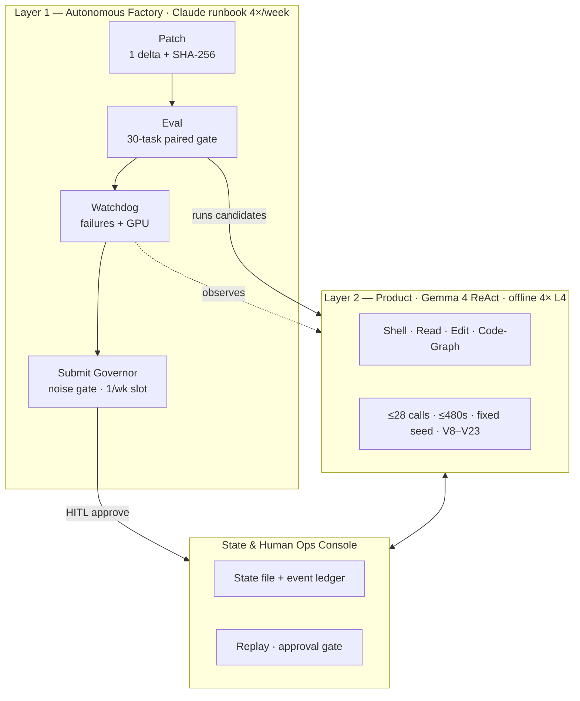

# NoiseGate Gemma 4 Factory

An autonomous **build → evaluate → submit** loop that separates real agent improvements from benchmark noise.

**Souriya Khaosanga · Adil Shamim** · CMU SCS Agentic AI · Fall 2026 · Kaggle [*Google DeepMind Gemma 4 Developer Agent*](https://www.kaggle.com/competitions/gemma-4-developer-agent)

The public notebook that shows **0.22** on the board scored **0.17** when we submitted the same artifact. Locally, baseline **V8** solves **8, then 6, then 8** in-budget on the same 30 tasks. With **one planned Kaggle submission per week** and ~**30 GPU hours** of weekly quota, a team that trusts a single score spends its budget promoting luck.

**Intended user:** a small engineering team iterating a coding agent under tight compute and submission limits.  
**Success:** ship a better agent only when evidence beats measured noise, at a known cost.  
**Out of scope:** fine-tuning Gemma; changing the competition harness.

| | |
|---|---|
| Best public score (base) | **0.18** (V8) |
| Gate noise band (V8, n=3) | mean **7.33** in-budget / 30 · ~**±2.5** tasks |
| Telemetry | **N=390** gate runs · median first edit at call **16/28** · **62.3%** out-of-budget |
| Deadline | **2026-12-02** 23:59 UTC |

**Links:** [Wiki Home](https://github.com/khaosans/noisegate-gemma4-factory/wiki/Home) · [Architecture](https://github.com/khaosans/noisegate-gemma4-factory/wiki/Architecture) · [Video](https://youtu.be/-EiKv_MafOY) · [Ops Console](https://claude.ai/artifact/6R7YzcGjHzh3U6dreF9YsW)

Editors sync wiki pages from in-repo [`docs/wiki/`](docs/wiki/).

## Architecture (Figure 1)

Three bands: a scheduled factory that governs promotion, a Gemma 4 ReAct product under hard caps, and a human Ops Console over an append-only ledger. The console never CreateSubmission — humans approve full gate runs and Kaggle submits.



Detail: [Architecture wiki](https://github.com/khaosans/noisegate-gemma4-factory/wiki/Architecture).

| | Product | Factory |
|---|---|---|
| Model | `gemma-4-31b-it` (competition-fixed) | Claude (scheduled runbook / Project) |
| Job | Fix issues under call/time budget | One delta → gate → maybe ship |
| Memory | Context window only | State file + append-only ledger + `results/` |
| Submit path | ADK `submission.zip` on Kaggle | Humans approve; ≤1 gated submit / week |

## How we ran it (primary loop)

The production climb path is **Claude Project + scheduled wakes**, not the local Streamlit console.

1. **Claude Cowork / Project** loads `factory/project-instructions.md`, the runbook, and `results/eval-results.md` on every wake.
2. **Skills** in [`factory/skills/`](factory/skills/) are the agentic procedures: `build-candidate` → `run-eval-gate` → `weekly-decision` → `record-score`.
3. **Cadence (UTC):** Sat build + Gate Run A · Sun Gate Run B · Mon decide + optional submit · other wakes status-only.
4. Login-heavy Kaggle UI (notebook commit, gate start, CreateSubmission) stays on Claude — that is where the authenticated browser session lives.

Paper Ops Console (replay + approval): [claude.ai artifact](https://claude.ai/artifact/6R7YzcGjHzh3U6dreF9YsW). Climb loop: [Claude Cowork Loop wiki](https://github.com/khaosans/noisegate-gemma4-factory/wiki/Claude-Cowork-Loop).

## Local path (query / demo without Claude login)

For demos and local operator queries:

- **Streamlit factory console** at **`:8765`** — [`factory_console/`](factory_console/), see [`docs/factory-console.md`](docs/factory-console.md)
- **Ollama** (optional chat backend) — OpenAI-compatible tools over the same `factory_console/actions.py` handlers
- **Offline mode** — keyword router when no live LLM is available

```bash
pip install -r requirements-console.txt -r requirements-agent.txt
streamlit run factory_console/app.py --server.port 8765
# open http://127.0.0.1:8765
```

The console may query records, replay the decision rule, run pytest / safety eval / zip build, and
(optionally) one supervised agent session. It **must not** start a Kaggle gate run, CreateSubmission,
or change the base config. Writes via `record_score` wait for an **Approve** click.

On the Mac demo host, a LaunchAgent (`com.noisegate.factory-console`) can KeepAlive the app on `:8765`.
Ollama chat (`FACTORY_CONSOLE_BACKEND`) and the climb/Kaggle read-only bridge (`CMU_AGENTIC_AI_ROOT`) are on `main` (#3, #4).

More: [Local and Streamlit wiki](https://github.com/khaosans/noisegate-gemma4-factory/wiki/Local-And-Streamlit).

## Requirements map

Course concepts → code: [`CONCEPTS.md`](CONCEPTS.md). Safety commitments → tests: [`docs/safety-plan.md`](docs/safety-plan.md).
HITL and competition constraints: [Requirements Compliance wiki](https://github.com/khaosans/noisegate-gemma4-factory/wiki/Requirements-Compliance).

Graded Kaggle ship path remains the **ADK agent zip**. The LangGraph supervisor in `supervisor/` is
course evidence (guardrails, budgets, escalate) and is **not** inside the competition submission.

## Repository map

| Path | What it is |
|---|---|
| [`product/`](product/) | Submitted agent config, build script, and every candidate's one change |
| [`harness/`](harness/) | Trajectory parser, evaluators E1–E9, SUBMIT/HOLD decision rule (tested) |
| [`harness/eval-gate/`](harness/eval-gate/) | Kaggle evaluation notebook and environment notes |
| [`supervisor/`](supervisor/) | LangGraph supervisor (course slice; not in the Kaggle zip) |
| [`guardrails/`](guardrails/) | Tool policy, budgets, patch checks, untrusted-text handling |
| [`agentops/`](agentops/) | JSONL run logs, safety-plan metrics, query CLI |
| [`factory_console/`](factory_console/) | Streamlit demo + operator chatbot ([docs](docs/factory-console.md)) |
| [`factory/`](factory/) | Runbook, Project instructions, four Claude Skills |
| [`evals/`](evals/) | Fixture repo + adversarial cases G6–G17 |
| [`results/`](results/) | Gate runs, leaderboard scores, calibration log |
| [GitHub Wiki](https://github.com/khaosans/noisegate-gemma4-factory/wiki/Home) · [`docs/wiki/`](docs/wiki/) | Demo wiki (preferred viewer); docs/wiki is editor SoT |
| [`docs/decisions/`](docs/decisions/) | Decision records |
| [`GOALS.md`](GOALS.md) · [`CONCEPTS.md`](CONCEPTS.md) | OKRs · concept → code map |

## Results (paper Table 1 strip)

Gate results through mid-November 2026. Do not treat these as a live leaderboard scrape.

| Version | Change | In-budget / 30 | Public LB | Gate verdict |
|---|---|---|---|---|
| V8 | Baseline | 8, 6, 8 (mean 7.33) | **0.18** (best) | Baseline |
| V11 | Reasoning / edit-deadline | 10 | 0.15 | Below +4.0 single-run bar |
| V15 | Exact copy of public 0.22 notebook | 7, 10 | 0.17 | Noise calibration |
| V18 | Heredoc edit recovery | 7, 7 | — | HOLD (gain −0.33) |
| V21 | Thinking 1024 → 2048 | 6 | — | HOLD |
| V22 | Best-guess edit on empty diff | 9 | — | HOLD (+1.67; needs 2nd run) |

Full tables: [`results/`](results/). Lessons: [`docs/lessons.md`](docs/lessons.md). Architecture + telemetry: [Architecture wiki](https://github.com/khaosans/noisegate-gemma4-factory/wiki/Architecture).

## Quick start

```bash
pip install -r requirements.txt
pytest -q                                  # decision rule, parser, guardrails, supervisor, safety eval
python -m evals.safety.run                 # adversarial cases: block rate + false positives
python -m agentops metrics                 # metrics over runs/ (see docs/agentops.md)
python product/build_submission.py         # rebuild submission.zip, print SHA-256s

pip install -r requirements-console.txt -r requirements-agent.txt
# Optional local LLM: ollama serve && ollama pull llama3.2:3b
# FACTORY_CONSOLE_BACKEND=ollama OLLAMA_HOST=http://127.0.0.1:11434 OLLAMA_MODEL=llama3.2:3b
streamlit run factory_console/app.py --server.port 8765
```

See [`docs/factory-console.md`](docs/factory-console.md) for Claude / Ollama / offline backend selection.

Parse an Eval Gate log and apply the rule:

```python
from harness.trajectory import parse_log
from harness.decision_rule import RunSummary, V8_HISTORY, decide, paired_net

rows = parse_log(open("gate_output.txt"))
cand = [r for r in rows if r.candidate == "C1"]
v8 = [r for r in rows if r.candidate == "V8"]
print(decide([RunSummary.from_results(cand)], V8_HISTORY + [RunSummary.from_results(v8)],
             run_b_paired_net=paired_net(cand, v8),
             zip_sha_ok=True, one_change_off_base=True, never_scored=True))
```

## Console backends (merged)

| PR | Status | What it adds |
|---|---|---|
| [#3](https://github.com/khaosans/noisegate-gemma4-factory/pull/3) | Merged | Local Ollama OpenAI-compatible chat backend (`FACTORY_CONSOLE_BACKEND`) |
| [#4](https://github.com/khaosans/noisegate-gemma4-factory/pull/4) | Merged | Read-only climb/Kaggle scoreboard bridge (`CMU_AGENTIC_AI_ROOT`); no CreateSubmission |

## Future work

- Keep submit HITL; use Ollama + climb bridge for local query only.
- Propose `record_score` from COMPLETE Kaggle rows (Approve still required).
- Enforce edit deadline in the tool layer (prompt-only deadline ignored on V17).
- Confirm V22 with a second paired run; frugal repeats on the nine contested tasks.
- Calibration: more decisive gate↔leaderboard points; re-measure noise.

Longer rationale: [Future Work wiki](https://github.com/khaosans/noisegate-gemma4-factory/wiki/Future-Work).

## What is not in this repo

Competition data and tasks, model weights, the GPU wheelhouse, Kaggle credentials, and other
teams' code. V15 is described and credited, not copied:
[flexonafft, *Budget-Aware Coding Agent v2*](https://www.kaggle.com/code/flexonafft/gemma-4-budget-aware-coding-agent-v2).

## License

MIT. See [`LICENSE`](LICENSE).
