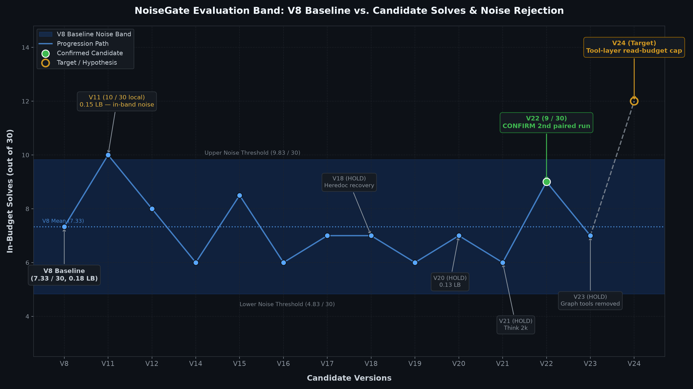

# Gemma 4 ADK Trajectory & Failure-Mode Eval Rubric

For the 28-call / 480s benchmark harness.

## 1. Visual Overview



**NoiseGate Evaluation Band.** Evaluated candidate pass rates against the empirical V8 baseline noise band (**7.33 ± 2.5** in-budget solves out of 30 tasks). Because single-run stochastic variance spans about **±2.5** solves, any candidate landing within this band (such as V14, V16–V21, and V23) reflects measurement noise rather than structural capability gains and is strictly **HOLD**.

Wiki mirror (preferred viewer): [Trajectory Eval Rubric](https://github.com/khaosans/noisegate-gemma4-factory/wiki/Trajectory-Eval-Rubric).

---

## 2. 4-Tier Trajectory Scoring Rubric

Each task execution in the 30-task evaluation gate is classified into one of four trajectory tiers based on recon latency, patch hygiene, verification discipline, and paired net signal.

| Rubric Axis | Exemplary (Tier 1) | Passing (Tier 2) | Degraded (Tier 3 - HOLD) | Failed (Tier 4 - REJECT) |
| :--- | :--- | :--- | :--- | :--- |
| **Recon Efficiency** | `first_edit ≤ 8`<br>Pinpoints issue location rapidly using precise symbol search or scoped file inspection without meandering. | `9 ≤ first_edit ≤ 14`<br>Bounded exploration; reads relevant contexts and transitions to edit phase within mid-budget. | `first_edit ≥ 15`<br>**Read-loop stall**. Matches the N=390 telemetry baseline where 62.3% of runs overrun call/time budgets. | `first_edit ≥ 28` or `None`<br>Exhausts calls or timeout without ever attempting a source edit. |
| **Patch Hygiene & Recovery** | **Clean unified diff** on first or second edit attempt.<br>Zero malformed calls; immediate recovery if edit fails. | Valid patch produced (`patch_size > 0`).<br>Recovers from syntax/heredoc errors within 1–2 retries (V18 recovery pattern). | Multiple edit match failures.<br>Relies on eleventh-hour fallback (V22 best-guess) without syntax confirmation. | `EMPTY_DIFF` (`patch_size == 0`), unrecovered syntax error, malformed tool JSON, or edits test files (`TEST_FILE_EDIT`). |
| **Verification Discipline** | Executes targeted test reproduction within calls 16–22.<br>Confirms regression passes before issuing final submission. | Runs reproduction command or exits cleanly before call 28 and 480s limit. | Verification omitted or attempted after call 26, risking timeout or call ceiling cutoff. | Overruns 28 calls or 480s ceiling while attempting tests; hangs process. |
| **Paired Net Signal** | `paired_net ≥ +3`<br>Clear task-level win margin against V8 on identical task seeds. | `paired_net ≥ +1`<br>Net positive win-loss margin (Δ ≥ +1.0 solve mean). | `paired_net ≤ 0`<br>Tied or negative task margin vs. baseline; in-band noise candidate. | `paired_net < -1`<br>Definite regression or hard check violation (test file modified, harness crash). |

---

## 3. Empirical Failure Taxonomy (V8–V23)

Analysis across 11 gate versions and N=390 task telemetry logs reveals three dominant failure modes. NoiseGate gates prevent these failures from consuming Kaggle daily submission slots.

| Failure Mode | Observed Candidate Runs & Manifestation | Mitigation & V24 Tool-Layer Hypothesis |
| :--- | :--- | :--- |
| **Read-Loop Overrun** | **V14, V16, V17, V19, V21**<br>Median first edit occurred at call 16/28; 62.3% of runs exceeded 28 calls or 480s due to repetitive `cat`/`sed` sweeps. V17 added a prompt bullet urging edits "by call 20", which Gemma 4 ignored because no step counter is visible in prompt context. | **V24 Tool-Layer Read-Budget Cap (Queued):** Enforce hard read limits directly within the tool execution layer (e.g., maximum 8 reads before restricting tool access to edit/write) rather than relying on prompt adherence. |
| **Empty / Malformed Diff** | **V8 (7 empty runs), V16 (9 empty runs), V17 (9 empty runs), V18 (7 empty runs)**<br>Agent spends all tool calls locating files and exits with `patch_size == 0`. Secondary cause: `edit_file` string replacement fails due to indentation/whitespace mismatch, and agent loops without recovery. | **V18 Heredoc Recovery + V22 Best-Guess Fallback:** On repeated `edit_file` failure, trigger raw python heredoc replacement (V18). If diff remains empty near call 22, force a best-guess source patch to ensure `patch_size > 0` (V22, CONFIRM). |
| **In-Band Noise Luck** | **V11 (10/30 local, 0.15 LB), V15 (10/30 local, 0.17 LB), V20 (7/30 local, 0.13 LB)**<br>Single-run evaluations show local spikes (+1.67 to +2.67 solves) that disappear on the Kaggle public leaderboard. V15 (identical copy of public 0.22 notebook) scored 0.17 for us, proving the leaderboard has about ±0.05 noise. | **Paired Gating & z-Score Thresholds:** Never promote a candidate on a single run. Require two paired runs vs. V8 with non-negative `paired_net`, delta ≥ +1.0 (or z ≥ 1.0), and strict hard-check verification before spending a UTC-day slot. |

---

## 4. Scoring a Gate Log

The evaluation harness parses per-task logs into typed `TaskResult` records (`harness/trajectory.py`). Use these attributes to compute individual task scores and aggregate gate verdicts:

```python
from harness.trajectory import TaskResult, parse_log
from harness.decision_rule import RunSummary, decide, paired_net

# Parse gate log lines
results: list[TaskResult] = parse_log(open("eval_output.log"))
```

### Key Field Mapping

| `TaskResult` Attribute | Type | Description & Rubric Assessment |
| :--- | :--- | :--- |
| `calls` | `int` | Total tool calls consumed. Must satisfy `calls <= 28` for `in_budget`. |
| `dur_s` | `float` | Wall-clock execution time. Must satisfy `dur_s <= 480.0` for `in_budget`. |
| `first_edit` | `Optional[int]` | Index of first file modification call. Primary indicator of **Recon Efficiency** (`≤8` Exemplary, `9-14` Passing, `≥15` Degraded, `None` Failed). |
| `mode` | `str` | Termination category (`SOLVED`, `EMPTY_DIFF`, `EDIT_FAIL`, `LOGIC_MISMATCH`, `TIMEOUT`). |
| `solved` | `bool` | Whether the test harness verified the issue solution. |
| `in_budget_solve` | `bool` | Property returning `solved and calls <= 28 and dur_s <= 480.0`. Core gate metric. |
| `empty_or_nonsource` | `bool` | Returns `True` if `mode == "EMPTY_DIFF"` or `len(src) == 0`. Triggers hard check warning if candidate exceeds V8 mean + 1. |
| `malformed` | `int` | Count of unparseable or rejected tool invocations. Degradation flag if > 0. |
| `badedits` | `int` | Number of failed `edit_file` search-and-replace attempts. |
| `reads` | `int` | Total file inspection calls; > 12 signals read-loop trap. |
| `src` | `list[str]` | Paths of modified files. If any modified path touches test directories, the run is hard-rejected (`test_file_edits > 0`). |
| `paired_net(cand, v8)` | `int` | Wins minus losses on in-budget solves across matched tasks. Must be ≥ 0 for any promotion. |
