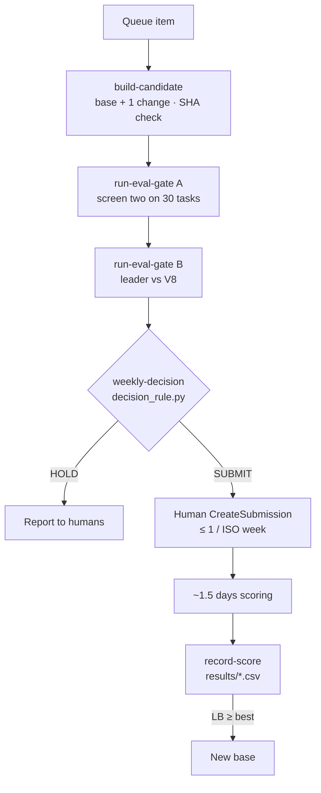
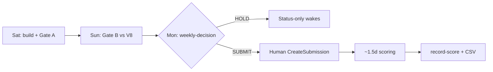
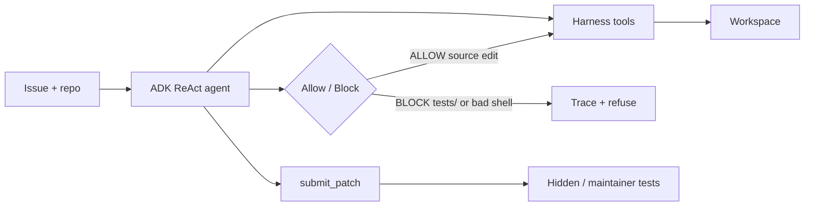
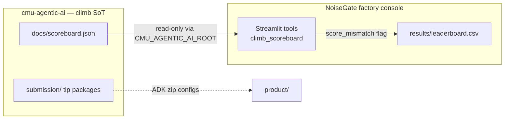

# Architecture

NoiseGate is deliberately two systems. Confusing them is the fastest way to mis-grade the project.

## Product vs factory

| | **Product** (Gemma 4 SuperAgent) | **Factory** (Claude climb loop) |
|---|---|---|
| Model | `gemma-4-31b-it` (fixed by competition rules) | Claude in a claude.ai Project / Cowork schedule |
| Artifact | ADK config → `submission.zip` on Kaggle | Candidates = current base + exactly one change |
| Tools | `edit_file`, shell, `git grep`, `submit_patch` | Kaggle notebooks, browser, dashboards, Skills |
| Evaluation | Hidden tests → public/private leaderboard | Local Eval Gate (30 tasks, 2 runs) + coded decision rule |
| Human role | — | Base config, cadence, final two private picks, CreateSubmission |

Core finding: **the harness matters more than the generator**. Same configs move ±2–3 in-budget solves per 30 and ~±0.05 on the leaderboard. The factory’s most useful act has been HOLD (V14, V16, V17).

## Data flow (one weekly turn)

Cadence view (UTC):

Decision logic lives in code (`harness/decision_rule.py`), not in free-form chat. Trajectory parsing and evaluators E1–E9 feed the gate; persistent memory is `results/`.

## Product ReAct loop (ADK)

What the graded agent does on each Kaggle task:

## Repository layout (who owns what)

| Path | Owner |
|---|---|
| `product/` | Product configs, candidates table, zip builder |
| `harness/` | Gate math, trajectory parse, eval notebook notes |
| `factory/` | Runbook, Project instructions, Skills |
| `factory_console/` | Local query/demo UI (does not replace Claude for Kaggle login) |
| `supervisor/` + `guardrails/` + `agentops/` | Course supervisor slice (LangGraph); **not** in the Kaggle zip |
| `evals/` | Adversarial safety cases |
| `results/` | Factory bookkeeping (gate CSV + leaderboard CSV) |

## Climb bridge (#4 merged)

Sibling climb tooling and the live publicScore source of truth live in `cmu-agentic-ai` (`docs/scoreboard.json`). NoiseGate’s `results/leaderboard.csv` is factory bookkeeping and can disagree until operators reconcile.

With [#4](https://github.com/khaosans/noisegate-gemma4-factory/pull/4) and Ollama [#3](https://github.com/khaosans/noisegate-gemma4-factory/pull/3) on `main`:

- Console tools `climb_scoreboard` / `kaggle_submissions_snapshot` read via `CMU_AGENTIC_AI_ROOT`
- `factory_status` can report `score_mismatch`
- Still **no** CreateSubmission, gate-start, or auto CSV overwrite from Streamlit

## What ships where

| Surface | Ships |
|---|---|
| Kaggle competition | Product ADK zip only |
| Class demo | Streamlit `:8765` + this wiki |
| Course evidence (non-zip) | LangGraph supervisor, guardrails, AgentOps, safety eval |

See also: [`Claude-Cowork-Loop.md`](Claude-Cowork-Loop.md), [`Local-And-Streamlit.md`](Local-And-Streamlit.md).
