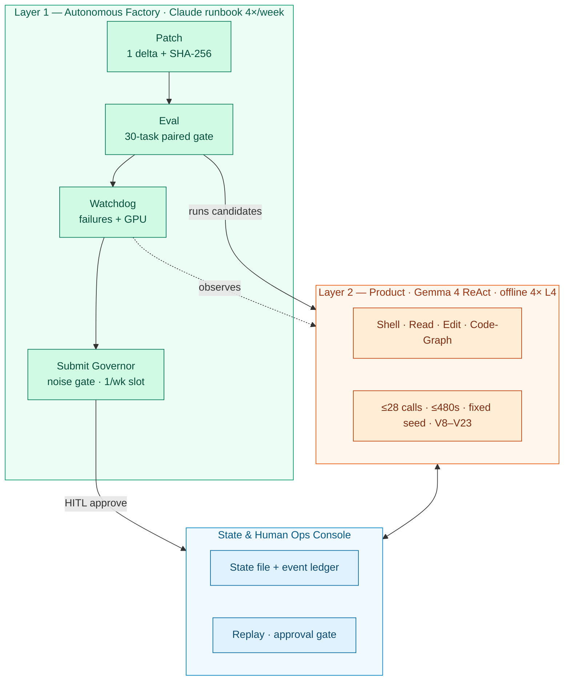
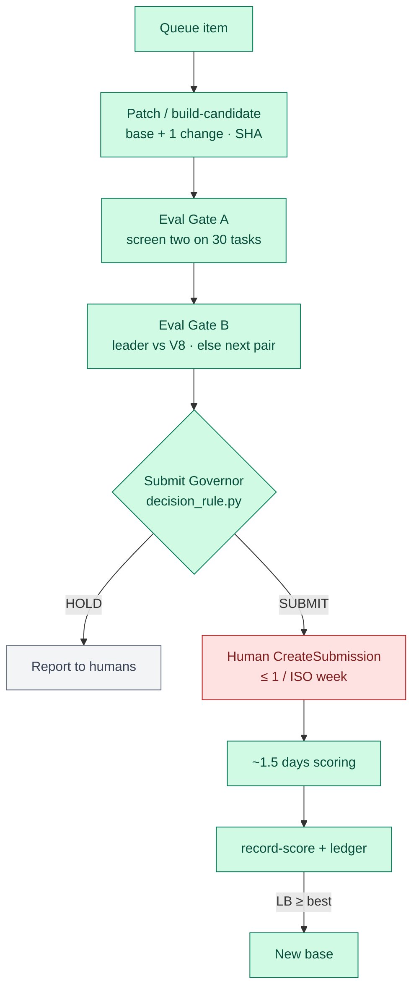
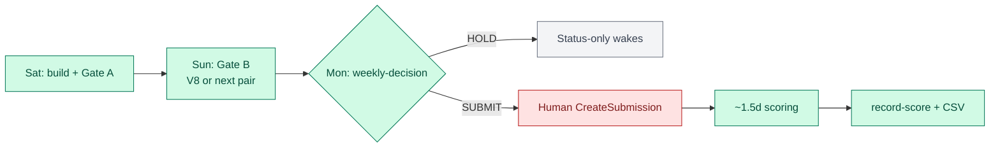
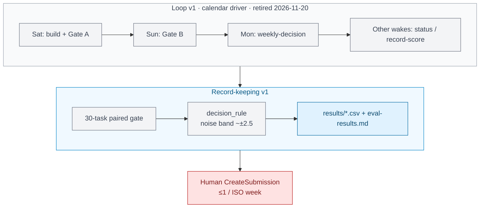
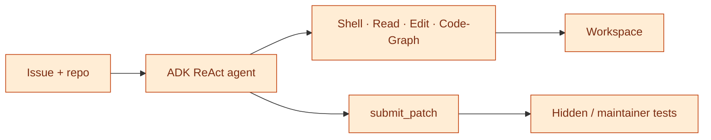
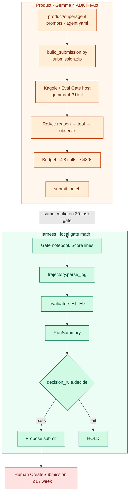
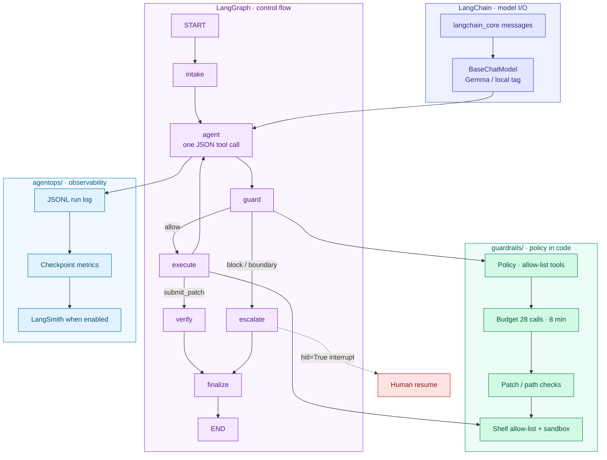
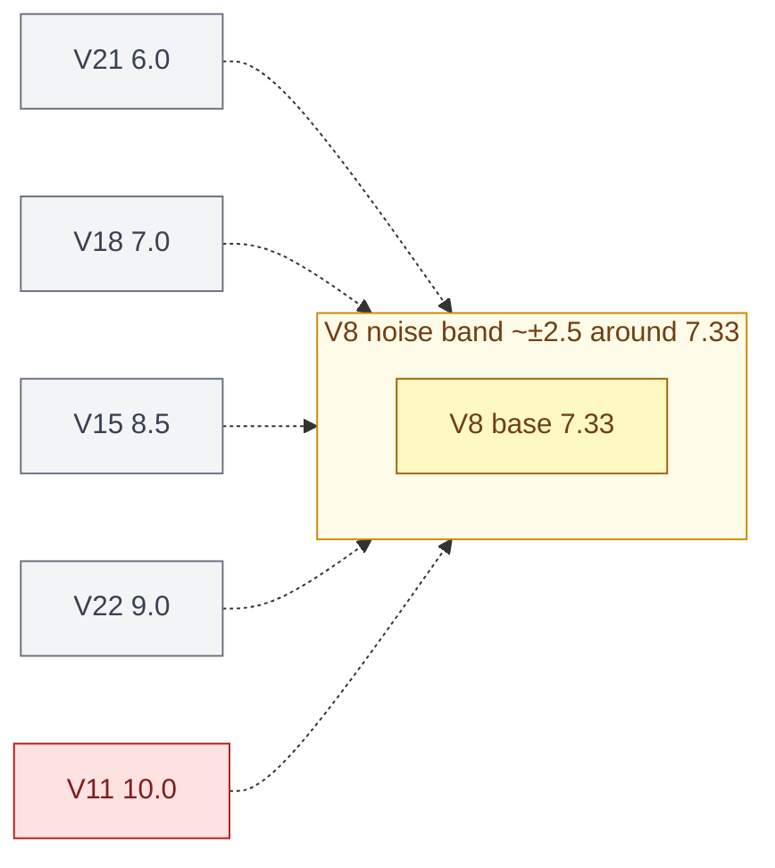
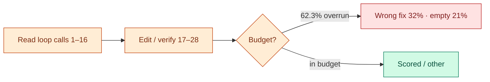
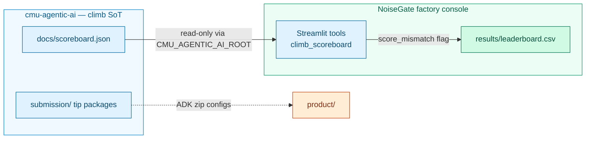

# Architecture

NoiseGate separates **deterministic factory governance** from the **offline Gemma 4 ReAct coding agent**, with humans on the Ops Console for costly steps. Confusing the bands is the fastest way to mis-read the project.

The product targets issue-fixing under a fixed competition harness (SWE-bench-style tasks; Kaggle ADK host). Behavior is a ReAct loop: reason → tool → observe → patch.

## Figure 1 — Three bands



*Insight.* Layer 1 decides **whether to spend GPU / the weekly slot**; Layer 2 only solves tasks. Ops is audit + HITL — never CreateSubmission.

| Band | What it does |
|---|---|
| **Factory (4 roles)** | Patch = base + one change (SHA-256). Eval = 30-task paired gate. Watchdog = failures + GPU. Submit Governor = noise gate + weekly slot. |
| **Product** | Gemma 4 ReAct under ≤28 calls / ≤480s / fixed seed. Configs V8–V23. |
| **Ops Console** | State file + append-only ledger; replay + approval. **Never** CreateSubmission. |

| | **Product** | **Factory** |
|---|---|---|
| Model | `gemma-4-31b-it` (fixed) | Claude scheduled runbook |
| Artifact | ADK → `submission.zip` | Base + exactly one change |
| Evaluation | Hidden tests → LB | Paired gate vs V8 + coded decision rule |
| Human role | — | Cadence, full-gate approve, CreateSubmission, final picks |

Core finding: **the harness matters more than the generator.** The factory’s most useful act has been HOLD.

## One weekly turn



*Insight.* Run A screens cheaply; Run B pairs a leader vs V8 (or the next pair). `decision_rule.py` makes HOLD/SUBMIT reproducible — not chat.

If **both** Run A candidates sit below V8’s mean, Run B screens the **next two** queue items instead of `[V8, leader]` (runbook; single-run bar applies).



*Insight.* Status-only wakes refresh scores without inventing submits; ~1.5d scoring lag → ≤1 gated submit / ISO week.

## Record-keeping cadence — before vs after

**Live since 2026-11-20: loop v2.** The Sat/Sun/Mon table above is still the **submit-slot skeleton** (≤1 gated CreateSubmission / ISO week). What changed is how wakes **choose work** and how **ledger / gate math** are recorded. Keep both diagrams when explaining the factory — v1 is how we used to run; v2 is how we record now.

### Before — loop v1 (calendar-driven)



*Insight.* v1: the **clock** decided the next action. Gate math and narrative lived almost entirely in `results/`.

### After — loop v2 (event-driven + wake ledger)

```mermaid
flowchart TB
  subgraph Drive["Loop v2 · event driver · live"]
    direction LR
    Plan[plan.py next] --> Act[START · WAIT · PARSE<br/>DEFER · IDLE · SKIP]
    Act --> Jobs[jobs[] · KEPT14 · z-gate]
  end

  subgraph Rec2["Record-keeping v2"]
    direction LR
    State[state.json key v2<br/>+ state.v1.json rollback] --> Led[history.log append-only]
    Led --> CSV2[results/*.csv + eval-results.md]
  end

  subgraph Keep["Unchanged skeleton"]
    direction LR
    Skel[Sat / Sun / Mon<br/>submit-slot table] --> Hitl2[Human CreateSubmission<br/>≤1 / ISO week]
  end

  Drive --> Rec2
  Jobs -.->|screens / confirms| Keep
  CSV2 -->|LB ≥ best| Base[New base]

  classDef live fill:#D1FAE5,stroke:#047857,color:#064E3B
  classDef record fill:#E0F2FE,stroke:#0369A1,color:#0C4A6E
  classDef hitl fill:#FEE2E2,stroke:#B91C1C,color:#7F1D1D
  classDef hold fill:#F3F4F6,stroke:#6B7280,color:#374151
  class Plan,Act,Jobs,Base live
  class State,Led,CSV2 record
  class Hitl2 hitl
  class Skel hold
  style Drive fill:#ECFDF5,stroke:#059669,color:#065F46
  style Rec2 fill:#F0F9FF,stroke:#0284C7,color:#075985
  style Keep fill:#FEF2F2,stroke:#DC2626,color:#7F1D1D
```

*Insight.* v2: **jobs + `plan.py`** decide the next action; every wake appends `history.log`. Gate decisions use **KEPT14 + z-gate** (T2 / SINGLE / CONFIRM). Human CreateSubmission and the weekly slot rule did **not** move into automation. Schemas: [`factory/state-and-artifacts.md`](https://github.com/khaosans/noisegate-gemma4-factory/blob/main/factory/state-and-artifacts.md) · climb narrative [[Claude-Cowork-Loop]].

| | **v1 (before)** | **v2 (after · live)** |
|---|---|---|
| What picks work | Fixed Sat / Sun / Mon / status calendar | `plan.py next` over `jobs[]` |
| Gate set | 30-task paired runs | **KEPT14** (V8 paired every run) |
| Ship rule | Noise-band `decision_rule` | **z-gate** + hard checks (over-budget ≤ V8 mean + 2) |
| Ledger | `results/` CSVs + `eval-results.md` | Same **plus** `history.log` + `state.json` `v2` |
| Human | CreateSubmission · base · cadence policy | **Same** (consoles still never submit) |

## Product ReAct loop (ADK zip)

Graded path only — what ships inside `submission.zip`:



*Insight.* Graded contract: one ADK agent → tools → patch → hidden tests. Allow/Block + escalate live in `supervisor/` / `guardrails/` — **not** in the zip. [[Requirements-Compliance]].

## Gemma agent + Eval Gate harness

How a candidate is measured before any weekly submit. Two bands: the **product** ReAct agent under the fixed competition contract, and the **harness** that turns notebook logs into HOLD/SUBMIT.



*Insight.* The ADK zip is the **generator**; `harness/` is the **evaluator**. Factory Skills start the gate notebook and append `results/`; `decide()` never invents a score. V8 baseline history loads from `results/gate_runs.csv`.

| Stage | Code | Output |
|---|---|---|
| Build candidate | `product/build_submission.py`, Skills `build-candidate` | Versioned zip + SHA-256 |
| Run paired gate | Kaggle Eval Gate notebook | Per-task `Score` lines |
| Parse / score | `harness/trajectory.py`, `evaluators.py` | Typed rows · E1–E9 |
| Decide | `harness/decision_rule.py` | HOLD / SUBMIT tier · Δ vs V8 |

## LangChain / LangGraph local stack

Course evidence only — **not** in the Kaggle zip. LangChain supplies chat messages; LangGraph owns control flow; `guardrails/` is plain Python with no LangChain imports (Decision 007).



*Insight.* The model **proposes**; code **decides**. Budgets and path policy run in `guard` / `execute`, including call counters injected into tool results (the lever prompt-only V17 lacked). Safety evals: `evals/safety` · 55/55 adversarial blocked, 0/29 false positives.

| Package | Role |
|---|---|
| `supervisor/` | LangGraph `StateGraph` — intake → agent → guard → execute → verify / escalate |
| `guardrails/` | Policy, budgets, patch checks, shell allow-list — no LangChain imports |
| `agentops/` | JSONL traces + checkpoint metrics; optional LangSmith |
| `evals/safety/` | Adversarial + benign twins through the full graph |

Ship contrast: [[Requirements-Compliance]] (ADK zip vs this stack).

## Figure 2 — Noise band and telemetry

Numbers from the capstone evaluation (gate through mid-November 2026). Not a live leaderboard scrape.

### A. Paired gate vs V8 noise band

V8 mean **7.33** in-budget / 30 · empirical noise ~**±2.5** (repeats 8, 6, 8).



*Insight.* In-band = noise, not a ship signal. V11’s local 10 → LB **0.15**; V15 (public 0.22) → **0.17**. The gate is trusted to refuse false promotions.

| Candidate | In-budget / 30 | Notes |
|---|---|---|
| V8 (base) | 7.33 (8, 6, 8) | Noise calibration |
| V11 | 10.0 (1 run) | Local win → LB 0.15 |
| V15 (public 0.22 copy) | 8.5 (7, 10) | LB 0.17 — board noise |
| V18 | 7.0 | HOLD |
| V21 | 6.0 | HOLD |
| V22 | 9.0 | CONFIRM — second paired run pending |

**Calibration tally** (local direction vs LB; from `results/README.md`):

| Point | Agree with LB? |
|-------|----------------|
| V11 | **No** (local better, LB worse) |
| V12 | **Yes** |
| V15 | Inconclusive (within noise) |

### B. Trajectory telemetry (N = 390)



*Insight.* Median first edit at call **16/28** — most budget is reading. Prompt-only deadlines (V17) failed; next lever is a **tool-layer** edit cap.

| Signal | Value | Takeaway |
|---|---|---|
| Median first edit | call **16 / 28** | Read loop too long |
| Out-of-budget | **243 / 390 (62.3%)** | Cap bites late |
| Wrong fix / empty patch | **32% / 21%** | Dominant failure modes |
| Prompt-only deadline (V17) | Ignored | Enforce in tools |

## Table 2 — Governance tiers

| Control tier | Operational action | Authorization & audit |
|---|---|---|
| **Autonomous** | Static checks, packaging, 3-hour screen on 9 contested tasks | Scheduled; logged in ledger |
| **Automated reliability cutoff** | Early stop when projected overruns fail hard check | Deterministic watchdog (~3.3 GPU-h saved on V18 replay) |
| **HITL gate** | Full 10-hour gate, Kaggle submission, failed recovery | Explicit human approval; overrides audited (e.g. V20) |
| **Hard standing guardrails** | Duplicate-hash resubmit, post-deadline runs, deleting notebooks/submissions | Forbidden; final submission human-reserved |

*Insight — why HITL tiers.* Cheap steps automate; expensive or irreversible steps require a person. That is how the factory stays autonomous without gambling the weekly slot or deleting artifacts.

The Claude Ops Console (**main** demo UI) may illustrate query / replay / approval — it **must not** CreateSubmission or start a Kaggle gate. See [[Ops-Console]].

## Repository layout

| Path | Owner |
|---|---|
| `product/` | Configs, candidates, zip builder |
| `harness/` | Gate math, trajectory parse |
| `factory/` | Runbook, Skills |
| `factory_console/` | Local query/demo UI |
| `supervisor/` + `guardrails/` + `agentops/` | Course slice — **not** in Kaggle zip |
| `evals/` · `results/` | Safety cases · bookkeeping |

## Climb bridge (#4 merged)



*Insight.* Climb `scoreboard.json` = live publicScore SoT; NG CSV = bookkeeping. Bridge is read-only — no CreateSubmission from Streamlit ([#4](https://github.com/khaosans/noisegate-gemma4-factory/pull/4), [#3](https://github.com/khaosans/noisegate-gemma4-factory/pull/3)).

## What ships where

| Surface | Ships |
|---|---|
| Kaggle | Product ADK zip only |
| Demo | Claude Ops Console (**main**) · this wiki |
| Course evidence (non-zip) | LangGraph supervisor, guardrails, AgentOps |

See also: [[Claude-Cowork-Loop]], [[Ops-Console]], [[Requirements-Compliance]].

## References

1. Jimenez et al., *SWE-bench* (ICLR 2024) — issue-fixing benchmark lineage.  
2. Yao et al., *ReAct* (ICLR 2023) — product agent loop.  
3. Kaggle & Google DeepMind, *Gemma 4 Developer Agent* (2026) — fixed model, 28 calls, 480s/task.
