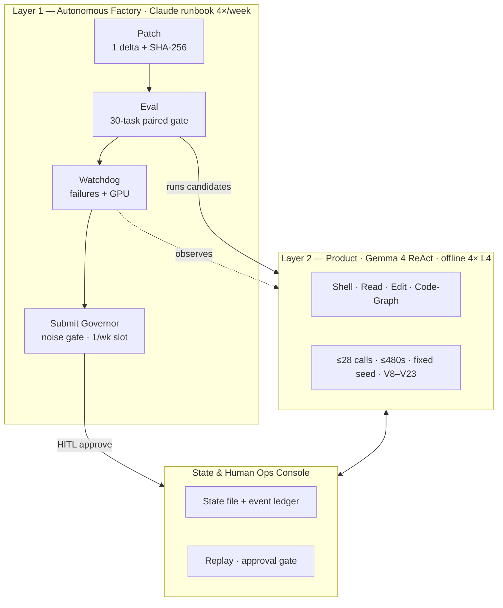
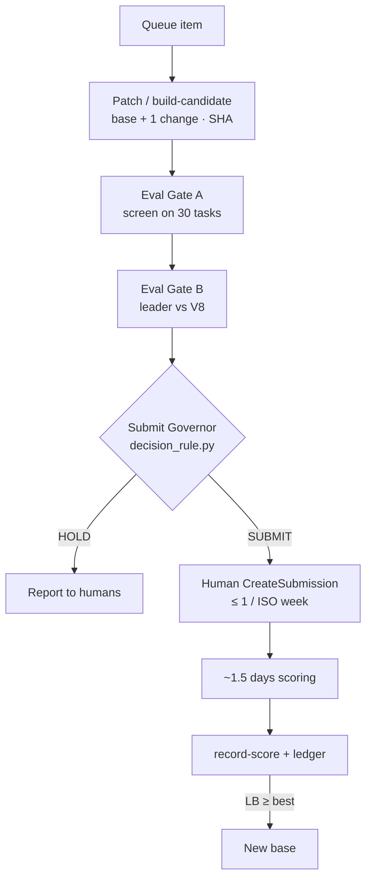
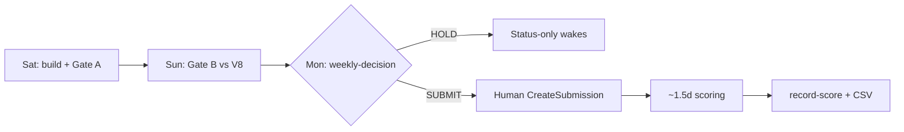
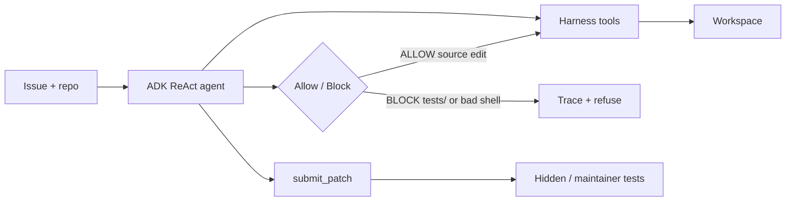
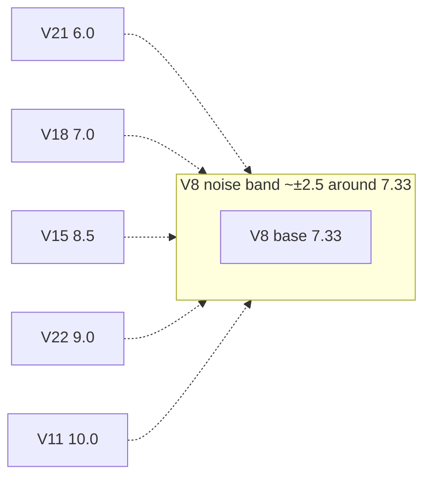
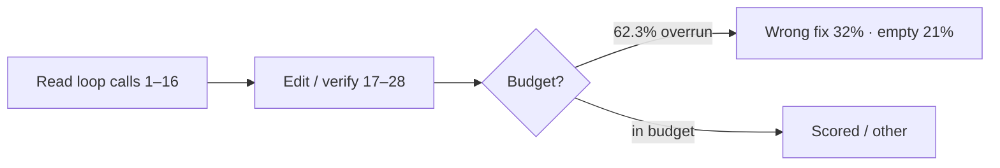
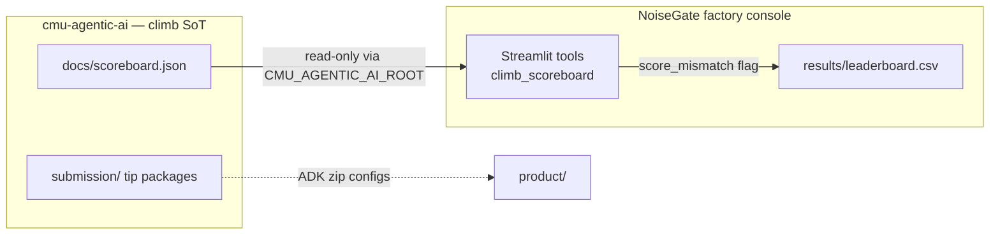

# Architecture

NoiseGate separates **deterministic factory governance** from the **offline Gemma 4 ReAct coding agent**, with humans on the Ops Console for costly steps. Confusing the bands is the fastest way to mis-read the project.

## Figure 1 — Three bands

| Band | What it does |
|---|---|
| **Factory (4 roles)** | Patch builds baseline + one change (SHA-256). Eval runs the 30-task paired gate. Watchdog classifies failures and tracks GPU. Submit Governor applies the noise gate and guards the weekly slot. |
| **Product** | Gemma 4 ReAct: reason → tool (shell / read / edit / code-graph) → observe → repeat until patch. Hard caps: ≤28 calls, ≤480s/task, fixed seed. Configs versioned V8–V23. |
| **Ops Console** | State file + append-only event ledger; React Ops Console with replay and approval. **Never** CreateSubmission from the console. |

| | **Product** | **Factory** |
|---|---|---|
| Model | `gemma-4-31b-it` (fixed by competition rules) | Claude scheduled runbook / Project |
| Artifact | ADK config → `submission.zip` | Candidates = base + exactly one change |
| Evaluation | Hidden tests → public/private LB | Local Eval Gate (30 tasks, paired vs V8) + coded decision rule |
| Human role | — | Cadence, full-gate approve, CreateSubmission, final picks |

Core finding: **the harness matters more than the generator**. The factory’s most useful act has been HOLD.

## One weekly turn

Cadence (UTC):

Decision logic lives in code (`harness/decision_rule.py`), not free-form chat. Trajectory parsing and evaluators E1–E9 feed the gate; persistent memory is the ledger + `results/`.

## Product ReAct loop (ADK)

## Figure 2 energy — noise band and telemetry

Numbers below are from the capstone evaluation writeup (gate through mid-November 2026). Not a live leaderboard scrape.

### A. Paired gate in-budget solves vs V8 noise band

V8 mean **7.33** in-budget / 30 · empirical noise ~**±2.5** tasks (three repeats: 8, 6, 8).

| Candidate | In-budget / 30 | Notes |
|---|---|---|
| V8 (base) | 7.33 (8, 6, 8) | Noise calibration |
| V11 | 10.0 (1 run) | Looked better locally → LB **0.15** |
| V15 (public 0.22 copy) | 8.5 (7, 10) | LB **0.17** — board noise |
| V18 | 7.0 | HOLD |
| V21 | 6.0 | HOLD |
| V22 | 9.0 | HOLD pending second run |

### B. Trajectory telemetry (N = 390 gate runs)

| Signal | Value | Takeaway |
|---|---|---|
| Median first edit | call **16 / 28** (~57% budget spent reading) | Agent reads too long |
| Out-of-budget | **243 / 390 (62.3%)** | Cap bites late |
| Wrong fix | **32%** | Dominant failure mode |
| Empty patch | **21%** | Second mode |
| Prompt-only “edit by call 20” (V17) | Ignored | Deadline must be **tool-layer**, not prompt-only |

## Table 2 — Governance tiers

| Control tier | Operational action | Authorization & audit |
|---|---|---|
| **Autonomous** | Static checks, candidate packaging, 3-hour screen on 9 contested tasks | Runs on schedule; logged in append-only ledger |
| **Automated reliability cutoff** | Early stop when projected overruns fail hard check | Deterministic watchdog (~3.3 GPU-h saved on V18 replay) |
| **HITL gate** | Full 10-hour 30-task gate, Kaggle submission, failed recovery | Explicit human approval; overrides audited (e.g. V20) |
| **Hard standing guardrails** | Duplicate-hash resubmit, post-deadline runs, deleting notebooks/submissions | Forbidden by policy; final submission human-reserved |

Streamlit `:8765` and the React Ops Console may query / replay / approve ledger writes — they **must not** CreateSubmission or start a Kaggle gate on their own.

## Repository layout (who owns what)

| Path | Owner |
|---|---|
| `product/` | Product configs, candidates table, zip builder |
| `harness/` | Gate math, trajectory parse, eval notebook notes |
| `factory/` | Runbook, Project instructions, Skills |
| `factory_console/` | Local query/demo UI (does not replace Claude for Kaggle login) |
| `supervisor/` + `guardrails/` + `agentops/` | Course supervisor slice (LangGraph); **not** in the Kaggle zip |
| `evals/` | Adversarial safety cases |
| `results/` | Factory bookkeeping (gate CSV + leaderboard CSV) |

## Climb bridge (#4 merged)

Sibling climb tooling and the live publicScore source of truth live in `cmu-agentic-ai` (`docs/scoreboard.json`). NoiseGate’s `results/leaderboard.csv` is factory bookkeeping and can disagree until operators reconcile.

With [#4](https://github.com/khaosans/noisegate-gemma4-factory/pull/4) and Ollama [#3](https://github.com/khaosans/noisegate-gemma4-factory/pull/3) on `main`:

- Console tools `climb_scoreboard` / `kaggle_submissions_snapshot` read via `CMU_AGENTIC_AI_ROOT`
- `factory_status` can report `score_mismatch`
- Still **no** CreateSubmission, gate-start, or auto CSV overwrite from Streamlit

## What ships where

| Surface | Ships |
|---|---|
| Kaggle competition | Product ADK zip only |
| Demo | Ops Console + Streamlit `:8765` + this wiki |
| Course evidence (non-zip) | LangGraph supervisor, guardrails, AgentOps, safety eval |

See also: [[Claude-Cowork-Loop]], [[Local-And-Streamlit]], [[Requirements-Compliance]].
