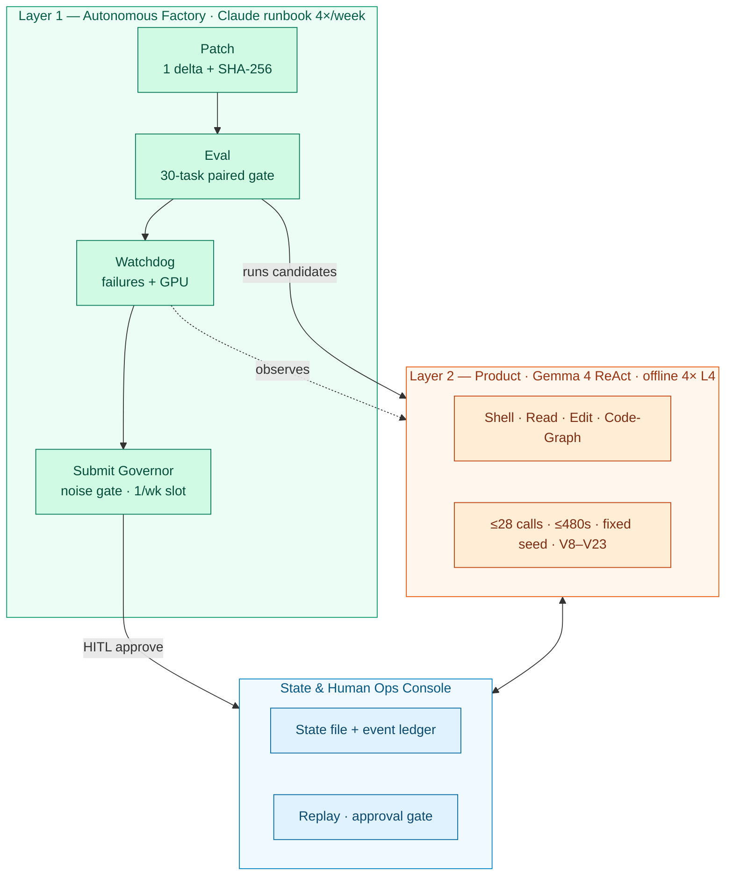
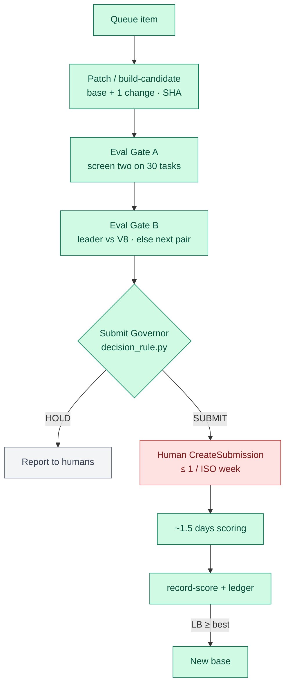
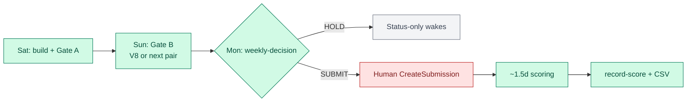
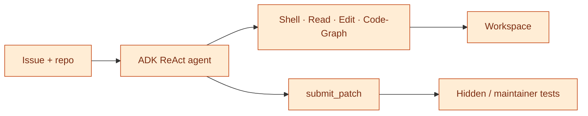
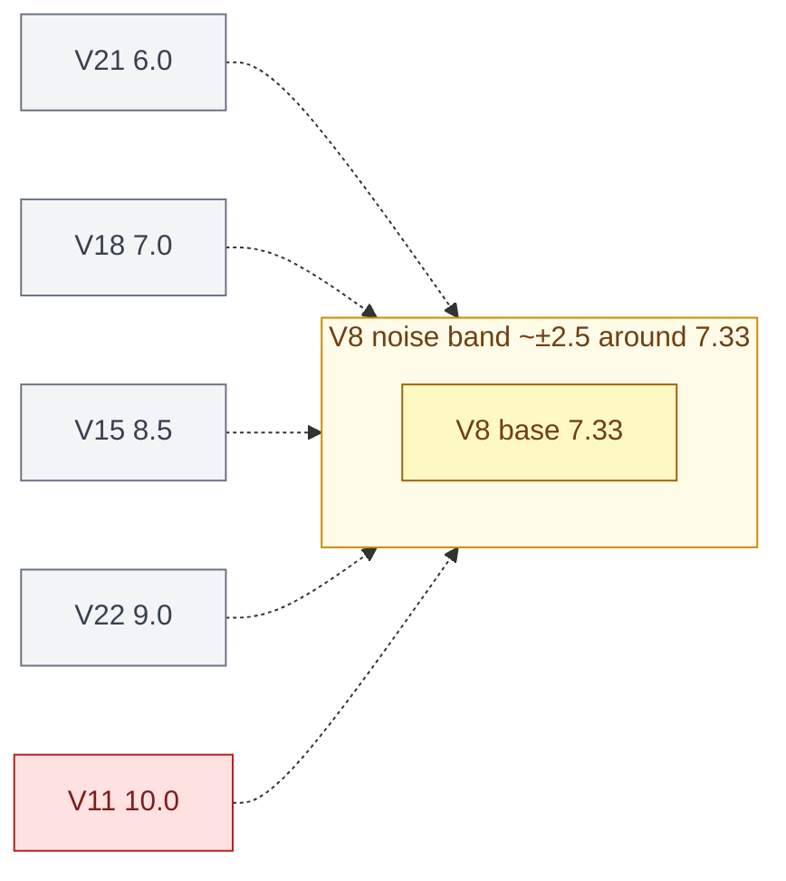
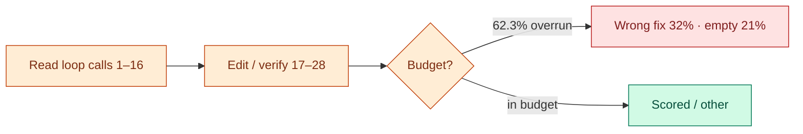
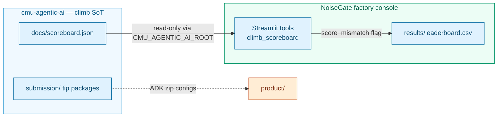

# Architecture

NoiseGate separates **deterministic factory governance** from the **offline Gemma 4 ReAct coding agent**, with humans on the Ops Console for costly steps. Confusing the bands is the fastest way to mis-read the project.

The product targets issue-fixing under a fixed competition harness (SWE-bench-style tasks; Kaggle ADK host). Behavior is a ReAct loop: reason → tool → observe → patch.

## Figure 1 — Three bands

**Legend (Figure 1)**

| Color | Band | Nodes |
|---|---|---|
| Green | Factory | Patch → Eval → Watchdog → Submit Governor |
| Amber | Product | Shell / Read / Edit / Code-Graph + budgets |
| Blue | Ops / HITL | State ledger + replay / approval gate |

*Insight — why three bands.* Layer 1 decides **whether to spend GPU and the weekly slot**; Layer 2 only solves tasks. Ops Console is the audit surface for humans, not a second climb path. CreateSubmission never leaves the HITL tier.

| Band | What it does |
|---|---|
| **Factory (4 roles)** | Patch = base + one change (SHA-256). Eval = 30-task paired gate. Watchdog = failures + GPU. Submit Governor = noise gate + weekly slot. |
| **Product** | Gemma 4 ReAct under ≤28 calls / ≤480s / fixed seed. Configs V8–V23. |
| **Ops Console** | State file + append-only ledger; replay + approval. **Never** CreateSubmission. |

| | **Product** | **Factory** |
|---|---|---|
| Model | `gemma-4-31b-it` (fixed) | Claude scheduled runbook |
| Artifact | ADK → `submission.zip` | Base + exactly one change |
| Evaluation | Hidden tests → LB | Paired gate vs V8 + coded decision rule |
| Human role | — | Cadence, full-gate approve, CreateSubmission, final picks |

Core finding: **the harness matters more than the generator.** The factory’s most useful act has been HOLD.

## One weekly turn

**Legend:** green = autonomous factory steps · gray = HOLD report · red = human CreateSubmission (HITL).

*Insight — why paired gate.* Run A screens two candidates cheaply; Run B only promotes a leader against V8 (or screens the next pair if both trail V8’s mean). Decision math is in `harness/decision_rule.py`, not chat — so HOLD/SUBMIT is reproducible.

If **both** Run A candidates sit below V8’s mean, Run B screens the **next two** queue items instead of `[V8, leader]` (runbook; single-run bar applies).

**Legend:** green = scheduled factory cadence · gray = HOLD / status-only · red = human CreateSubmission.

*Insight — cadence.* Status-only wakes exist so Claude refreshes scores without inventing submits. The ~1.5-day scoring lag is why the factory self-limits to ≤1 gated submit / ISO week.

## Product ReAct loop (ADK zip)

Graded path only — what ships inside `submission.zip`:

**Legend:** amber = product ReAct path inside the ADK zip (graded ship).

*Insight.* This is the competition contract: one ADK agent, tools, patch, hidden tests. **Allow / Block**, budgets, and escalate interrupts live in local `supervisor/` + `guardrails/` — course evidence, **not** in the zip. See [[Requirements-Compliance]].

## Figure 2 — Noise band and telemetry

Numbers from the capstone evaluation (gate through mid-November 2026). Not a live leaderboard scrape.

### A. Paired gate vs V8 noise band

V8 mean **7.33** in-budget / 30 · empirical noise ~**±2.5** (repeats 8, 6, 8).

**Legend (Figure 2A):** yellow = V8 noise band · gray = candidates treated as in-band HOLD · red = false-positive local win (V11 → LB 0.15).

*Insight — shipping decisions.* Anything inside the band is treated as noise, not a ship signal. V11’s single-run 10 looked decisive and then scored **0.15** on the board; V15 (public 0.22 copy) landed **0.17**. The gate’s job is blocking false promotions; it is trusted more to refuse than to forecast LB.

| Candidate | In-budget / 30 | Notes |
|---|---|---|
| V8 (base) | 7.33 (8, 6, 8) | Noise calibration |
| V11 | 10.0 (1 run) | Local win → LB 0.15 |
| V15 (public 0.22 copy) | 8.5 (7, 10) | LB 0.17 — board noise |
| V18 | 7.0 | HOLD |
| V21 | 6.0 | HOLD |
| V22 | 9.0 | HOLD pending second run |

### B. Trajectory telemetry (N = 390)

**Legend (Figure 2B):** amber = trajectory phases · red = dominant failure modes (wrong fix / empty / overrun) · green = in-budget outcomes.

*Insight — next engineering lever.* Median first edit at call **16/28** means most of the budget is spent reading. Prompt-only “edit by call 20” (V17) was ignored — so a **tool-layer** call/edit deadline is the honest next change, not another system-prompt pep talk.

| Signal | Value | Takeaway |
|---|---|---|
| Median first edit | call **16 / 28** | Read loop too long |
| Out-of-budget | **243 / 390 (62.3%)** | Cap bites late |
| Wrong fix / empty patch | **32% / 21%** | Dominant failure modes |
| Prompt-only deadline (V17) | Ignored | Enforce in tools |

## Table 2 — Governance tiers

| Control tier | Operational action | Authorization & audit |
|---|---|---|
| **Autonomous** | Static checks, packaging, 3-hour screen on 9 contested tasks | Scheduled; logged in ledger |
| **Automated reliability cutoff** | Early stop when projected overruns fail hard check | Deterministic watchdog (~3.3 GPU-h saved on V18 replay) |
| **HITL gate** | Full 10-hour gate, Kaggle submission, failed recovery | Explicit human approval; overrides audited (e.g. V20) |
| **Hard standing guardrails** | Duplicate-hash resubmit, post-deadline runs, deleting notebooks/submissions | Forbidden; final submission human-reserved |

*Insight — why HITL tiers.* Cheap steps automate; expensive or irreversible steps require a person. That is how the factory stays autonomous without gambling the weekly slot or deleting artifacts.

Streamlit `:8765` and the React Ops Console may query / replay / approve ledger writes — they **must not** CreateSubmission or start a Kaggle gate on their own.

## Repository layout

| Path | Owner |
|---|---|
| `product/` | Configs, candidates, zip builder |
| `harness/` | Gate math, trajectory parse |
| `factory/` | Runbook, Skills |
| `factory_console/` | Local query/demo UI |
| `supervisor/` + `guardrails/` + `agentops/` | Course slice — **not** in Kaggle zip |
| `evals/` · `results/` | Safety cases · bookkeeping |

## Climb bridge (#4 merged)

**Legend:** blue = climb SoT / console bridge (read-only) · amber = product zip configs · green band = NoiseGate bookkeeping.

*Insight.* Climb `scoreboard.json` is live publicScore SoT; NoiseGate CSV is factory bookkeeping. The bridge is read-only — still **no** CreateSubmission from Streamlit ([#4](https://github.com/khaosans/noisegate-gemma4-factory/pull/4), [#3](https://github.com/khaosans/noisegate-gemma4-factory/pull/3)).

## What ships where

| Surface | Ships |
|---|---|
| Kaggle | Product ADK zip only |
| Demo | Ops Console + Streamlit `:8765` + this wiki |
| Course evidence (non-zip) | LangGraph supervisor, guardrails, AgentOps |

See also: [[Claude-Cowork-Loop]], [[Local-And-Streamlit]], [[Requirements-Compliance]].

## References

1. Jimenez et al., *SWE-bench* (ICLR 2024) — issue-fixing benchmark lineage.  
2. Yao et al., *ReAct* (ICLR 2023) — product agent loop.  
3. Kaggle & Google DeepMind, *Gemma 4 Developer Agent* (2026) — fixed model, 28 calls, 480s/task.
