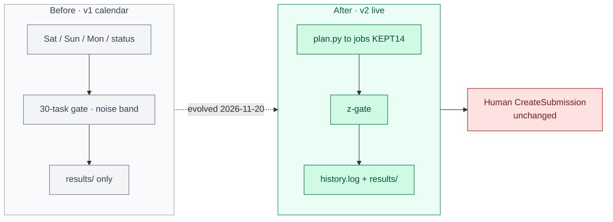

# Claude Cowork loop (primary agentic path)

The factory’s **production** climb path is Claude Cowork. Cowork / Project wakes hold the authenticated Kaggle browser session needed for notebook commit, Eval Gate starts, and CreateSubmission.

Cowork project artifact: [claude.ai/artifact/1Ldx2khByugozsHH5cuLfa](https://claude.ai/artifact/1Ldx2khByugozsHH5cuLfa).  
**Main Ops Console** (demo / paper replay): [claude.ai/artifact/6R7YzcGjHzh3U6dreF9YsW](https://claude.ai/artifact/6R7YzcGjHzh3U6dreF9YsW) — full docs [[Ops-Console]].  
In-repo procedures: [`factory/`](https://github.com/khaosans/noisegate-gemma4-factory/tree/main/factory) (`project-instructions.md`, `runbook.md`, `skills/*/SKILL.md`).

**Quick split:** Cowork = authenticated climb (gate start / human CreateSubmission). [[Ops-Console]] = **main** demo / ops UI (paper/replay). The Ops Console never submits.

## Why Claude holds login-heavy ops

| Action | Why on Cowork (not the Ops Console) |
|---|---|
| Import / Save & Run All on SuperAgent notebook | Needs logged-in Kaggle UI |
| Start Eval Gate on 4× L4 | GPU quota + notebook auth |
| CreateSubmission | Human-reserved; daily/weekly limits |
| Dashboard refresh after scoring | Session + judgment on unexpected UI |

The Ops Console is a **demo / replay surface** over recorded factory state. It deliberately cannot start gates or submit.

## Schedule (UTC)

From [`factory/runbook.md`](https://github.com/khaosans/noisegate-gemma4-factory/blob/main/factory/runbook.md). GPU quota resets weekly (by Sat 00:30 UTC).

### Before — loop v1 calendar (still the submit-slot skeleton)

| Day | Work |
|---|---|
| **Sat** | Build top queue items as C1/C2 (base + one change); Gate **Run A** screen |
| **Sun** | Gate **Run B**: leader vs V8 (or next pair if both below V8 mean) |
| **Mon** | Apply `decision_rule.py`; on SUBMIT ask a human to approve CreateSubmission; ≤1 gated submit / ISO week |
| Other wakes | Status only: record scores, refresh dashboards |

Planned submission slots (from runbook): Nov 9, 16, 23, 30. No gate runs after Nov 30. Final deadline **2026-12-02**.

### After — loop v2 (live since 2026-11-20)

The table above remains the **submit-slot skeleton**. Live record-keeping and work selection are **event-driven**:

| Piece | Now |
|---|---|
| Driver | `jobs[]` in climb `state.json` (`v2`) · `plan.py next` → START / WAIT / PARSE / DEFER / IDLE / SKIP |
| Gate | **KEPT14** task set · V8 paired every run · **z-gate** (T2 / SINGLE / CONFIRM) |
| Ledger | Append-only `history.log` every wake · same `results/*.csv` + `eval-results.md` |
| Rollback | `state.v1.json` kept; do not hand-edit state outside a wake |

*Insight.* Explain **both**: v1 is the familiar week shape; v2 is how wakes actually pick jobs and append the ledger. Full before/after bands: [[Architecture]]. Current queue state (V22 confirm / V24 queued) lives in the runbook "Current state" section. Schemas: [`factory/state-and-artifacts.md`](https://github.com/khaosans/noisegate-gemma4-factory/blob/main/factory/state-and-artifacts.md).

## Skills (procedural memory)

| Skill | Role |
|---|---|
| `build-candidate` | Export base, apply exactly one change, verify diff + SHA-256 |
| `run-eval-gate` | Drive Gate Run A (screen two) / Run B (leader vs V8, or next pair if both trail V8) |
| `weekly-decision` | Apply coded SUBMIT/HOLD rule; report to humans |
| `record-score` | After LB returns, update `results/` and note gate↔LB agreement |

Project knowledge on every wake: runbook + `results/eval-results.md`. System prompt: `factory/project-instructions.md`.

## Human decisions the loop never makes

- Base config (e.g. 2026-11-07 rollback to V8; V15 lineage retired as base)
- Cadence (one gated submission / week; two candidates screened / week)
- Final two selections for private scoring
- CreateSubmission itself

## Cost guardrails

- One gate run at a time; start only with ≥12 GPU-quota hours left; two runs per quota week
- On run error: fix only a clear harness bug and re-run once; second error stops the loop
- No ad-hoc runs, larger task sets, or interactive GPU sessions
- Same UI step fails 3× → stop and report

## Relation to the Ops Console

Classmates follow the factory story on the [[Ops-Console]] Claude artifact (main demo UI). The authentic climb still goes through this Cowork loop.
