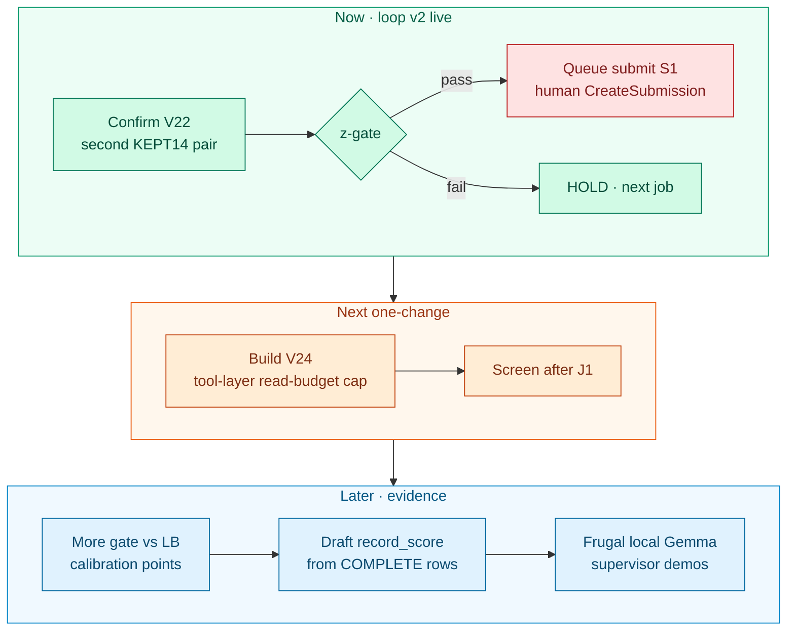

# Future work

What is next on the NoiseGate climb — ordered by ship risk. None of these expand the competition MVP past the frozen ADK zip path. Cadence context (loop v1 vs v2): [[Architecture]] · [[Claude-Cowork-Loop]].

**Deadline:** competition closes **2026-12-02 23:59 UTC**. Public sprint checklist + HITL remaining: [`docs/sprint-pre-dec2.md`](https://github.com/khaosans/noisegate-gemma4-factory/blob/main/docs/sprint-pre-dec2.md).

## Priority map

*Insight.* Finish open confirm jobs before inventing new hypotheses. CreateSubmission stays human; slot law is [[Submit-Policy]] (1 / UTC day + bars).

| Priority | Item | Status |
|---|---|---|
| **P0** | Confirm V22 (job J1 = V8 vs V22, KEPT14 × 2) | In flight / next wake |
| **P1** | Build + screen **V24** (tool-layer read-budget cap) | Queued hypothesis — not shipped |
| **P2** | More decisive gate↔LB calibration points | Partial (see [[Requirements-Compliance]]) |
| **P3** | Draft `record_score` from COMPLETE Kaggle rows | Not started |
| **P4** | Frugal local Gemma supervisor demos | Optional course evidence |
| Done | Ops Console main UI · Ollama/climb bridge · loop v2 ledger | Merged / live |

## P0 — Confirm V22

**Why:** One KEPT14 run put V22 in CONFIRM (z ≈ 1.08). Loop v2 needs the second paired run before any submit slot.

**Done when:** J1 parsed into `results/` + wake ledger; z-gate verdict logged; on pass, humans may CreateSubmission (S1) — consoles never click it.

## P1 — V24 tool-layer read-budget cap (**hypothesis — not shipped**)

**Why:** Telemetry (N=390): median first edit ~call 16/28; 62% overruns. Prompt-only deadlines (V17) failed. Enforce the budget in the **tool layer**, not the prompt.

**Constraints:** Exactly one change off base; screen only after J1 is decided; HOLD discipline unchanged.

**Not claiming:** that this is implemented or LB-validated.

## P2 — Calibration: more decisive gate↔leaderboard points

**Why:** Want ≥2 of 3 scored points agreeing in direction with the leaderboard. Noise is still large (±3 local, ±0.05 LB).

**Done when:** Updated rows in `results/README.md`; explicit agree / disagree / inconclusive tally vs GOALS.

## P3 — Draft `record_score` from COMPLETE Kaggle rows

**Why:** After a tip scores, draft the CSV/log entry from COMPLETE rows instead of retyping. **Approve** still gates any write.

**Done when:** A queued `record_score` payload can be filled from climb/Kaggle COMPLETE data; no auto CSV overwrite.

## P4 — Frugal local Gemma supervisor demos

**Why:** Supervised tool loops with guardrails for demos without burning Kaggle GPU (Ollama / local tag).

**Constraints:** Sandbox-required; **not** in the ADK zip; never described as competition evidence about the hosted Gemma runtime.

## Already shipped (do not re-open as “next”)

| Item | Where |
|---|---|
| Claude Ops Console as **main** demo UI | [[Ops-Console]] |
| Ollama + climb/Kaggle read-only bridge | PRs [#3](https://github.com/khaosans/noisegate-gemma4-factory/pull/3), [#4](https://github.com/khaosans/noisegate-gemma4-factory/pull/4) |
| Loop v2 event-driven ledger (KEPT14, z-gate, `history.log`) | [[Architecture]] · [[Claude-Cowork-Loop]] · `factory/state-and-artifacts.md` |

## Optional course fallback evidence pack

If graders need a non-competition narrative: LangSmith (or AgentOps) traces + one guardrail story + 3–5 golden cases from `evals/` / recorded sessions — without inventing a second product.

**Done when:** A short index under `docs/` or the presentation map points at those artifacts. Update PROBLEM.md only if the graded track formally falls back.

## Non-goals (still)

- CreateSubmission from any console (Ops Console, Streamlit, or Cowork without human yes)
- Secrets or credentials in-repo
- Re-implementing Agent OS here
- Treating Ops Console numbers as live inventable scores (replay only)
- Expanding MVP past the frozen ADK ship path
- Publishing tuned prompt sweeps, ensemble weights, or leakage finds on this public surface (private sibling `cmu-agentic-ai` only)

## Blocked imports (do not invent)

| Bundle / branch | Status |
|---|---|
| Checkpoint 6.1 (`feat/checkpoint-6-1-governance`) | Sync folder missing on cloud VMs — patch-quality / soft-tier / review packets not on `main` yet |
| SWE-bench Lite pre-gate (`feat/swebench-pregate`) | Same — runner not imported; do not recreate from chat notes |
