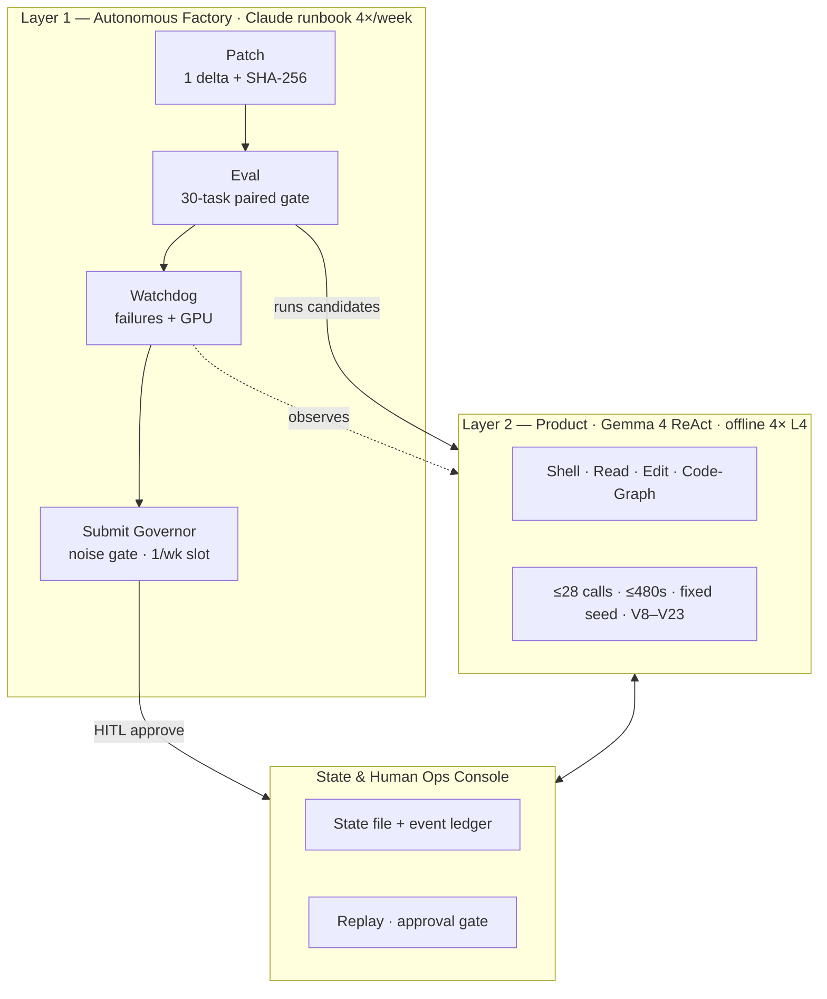

# NoiseGate Gemma 4 Factory

> **Preferred viewer:** this [GitHub Wiki](https://github.com/khaosans/noisegate-gemma4-factory/wiki/Home). Editors keep the markdown SoT in-repo under `docs/wiki/` and sync here.

An autonomous **build → evaluate → submit** loop that separates real agent improvements from benchmark noise.

The public notebook that shows **0.22** scored **0.17** when we submitted the same artifact. Baseline **V8** fluctuates **8 / 6 / 8** in-budget on the same 30 tasks. With **one planned submission per week** and ~**30 GPU hours** of quota, trusting a single score burns luck.

| | |
|---|---|
| Authors | Souriya Khaosanga · Adil Shamim |
| Competition | [Kaggle *Gemma 4 Developer Agent*](https://www.kaggle.com/competitions/gemma-4-developer-agent) · deadline 2026-12-02 |
| Best public (base) | **0.18** (V8) |
| Repo | [noisegate-gemma4-factory](https://github.com/khaosans/noisegate-gemma4-factory) |
| Video | https://youtu.be/-EiKv_MafOY |
| Ops Console | https://claude.ai/artifact/6R7YzcGjHzh3U6dreF9YsW |

### Architecture at a glance (Figure 1)

Three bands — factory governance, product ReAct agent, human Ops Console. Console never CreateSubmission.

More: [[Architecture]] (noise band, telemetry, governance tiers).

## Demo in under a minute

1. Open the [Ops Console](https://claude.ai/artifact/6R7YzcGjHzh3U6dreF9YsW) for replay / noise-band dashboard, **or** `streamlit run factory_console/app.py --server.port 8765` → http://127.0.0.1:8765
2. Show a HOLD above the V8 noise band (e.g. ask why V18 / V21 / V17).
3. Point at Claude Skills + schedule for the authenticated climb — not the console for CreateSubmission.

Talk track: [[Demo-Script]].

## Pages

| Page | Purpose |
|---|---|
| [[Architecture]] | Figure 1 bands · weekly turn · Figure 2 noise/telemetry · Table 2 governance |
| [[Claude-Cowork-Loop]] | Schedule, Skills, why Claude holds Kaggle login ops |
| [[Local-And-Streamlit]] | Ollama, `:8765`, what the console may / must not do |
| [[Requirements-Compliance]] | Concepts → code; ADK zip vs LangGraph; HITL |
| [[Future-Work]] | Honest next steps |
| [[Demo-Script]] | 3–5 minute talk track |

## Primary sources in the repo

| Doc | Role |
|---|---|
| [CONCEPTS.md](https://github.com/khaosans/noisegate-gemma4-factory/blob/main/CONCEPTS.md) | Concept → code evidence |
| [factory/runbook.md](https://github.com/khaosans/noisegate-gemma4-factory/blob/main/factory/runbook.md) | Climb cadence + human decisions |
| [docs/factory-console.md](https://github.com/khaosans/noisegate-gemma4-factory/blob/main/docs/factory-console.md) | Console pages and chat backends |
| [docs/safety-plan.md](https://github.com/khaosans/noisegate-gemma4-factory/blob/main/docs/safety-plan.md) | Safety commitments → tests |
| [GOALS.md](https://github.com/khaosans/noisegate-gemma4-factory/blob/main/GOALS.md) | OKRs |

## Console upgrades on `main`

- [#3](https://github.com/khaosans/noisegate-gemma4-factory/pull/3) — Ollama chat backend for the console (merged)  
- [#4](https://github.com/khaosans/noisegate-gemma4-factory/pull/4) — climb/Kaggle read-only scoreboard bridge (merged)  
