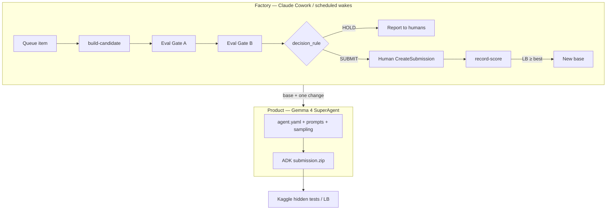

# NoiseGate class wiki

> **Preferred viewer:** [https://github.com/khaosans/noisegate-gemma4-factory/wiki](https://github.com/khaosans/noisegate-gemma4-factory/wiki). This `docs/wiki/` tree remains the in-repo source of truth; edit here, then sync to the GitHub Wiki.

**60-second story.** We ship a Gemma 4 coding agent (the product) and a Claude-run factory that tries to improve it one change at a time. The factory’s Eval Gate and decision rule refuse to ship noise — V14, V16, and V17 were held; the live base remains **V8 at public 0.18**. For demos, open the Streamlit console at `:8765` (query/replay without Claude login). For the real climb, Claude Cowork + Skills own the Kaggle login path.

| | |
|---|---|
| Course | CMU SCS Agentic AI · Fall 2026 |
| Authors | Souriya Khaosanga · Adil Shamim |
| Competition | Kaggle *Google DeepMind Gemma 4 Developer Agent* · deadline 2026-12-02 |
| Repo front door | [`README.md`](../../README.md) |

### Dual systems at a glance

More detail: [`Architecture.md`](Architecture.md).

## Demo in under a minute

1. `streamlit run factory_console/app.py --server.port 8765` → [http://127.0.0.1:8765](http://127.0.0.1:8765)
2. Open **Factory loop** — best score, base V8, what the runbook says is due.
3. Open **One turn of the loop** or ask Operator chat `why V17` — show a HOLD above the noise band.
4. Point at Claude Skills + schedule for the authenticated climb (not the console).

Talk track: [`Demo-Script.md`](Demo-Script.md).

## Pages

| Page | Purpose |
|---|---|
| [`Architecture.md`](Architecture.md) | Product vs factory; data flow; climb bridge |
| [`Claude-Cowork-Loop.md`](Claude-Cowork-Loop.md) | Schedule, Skills, why Claude holds Kaggle login ops |
| [`Local-And-Streamlit.md`](Local-And-Streamlit.md) | Ollama, `:8765`, what the console may / must not do |
| [`Requirements-Compliance.md`](Requirements-Compliance.md) | Course concepts → code; competition + HITL |
| [`Future-Work.md`](Future-Work.md) | Honest next steps |
| [`Demo-Script.md`](Demo-Script.md) | 3–5 minute talk track |

## Primary sources in the repo

| Doc | Role |
|---|---|
| [`CONCEPTS.md`](../../CONCEPTS.md) | Concept → code evidence |
| [`factory/runbook.md`](../../factory/runbook.md) | Climb cadence + human decisions |
| [`docs/factory-console.md`](../factory-console.md) | Console pages and chat backends |
| [`docs/safety-plan.md`](../safety-plan.md) | Checkpoint 6.1 → tests |
| [`GOALS.md`](../../GOALS.md) | OKRs |

## Console upgrades on `main`

- [#3](https://github.com/khaosans/noisegate-gemma4-factory/pull/3) — Ollama chat backend for the console (merged)  
- [#4](https://github.com/khaosans/noisegate-gemma4-factory/pull/4) — climb/Kaggle read-only scoreboard bridge (merged)  
