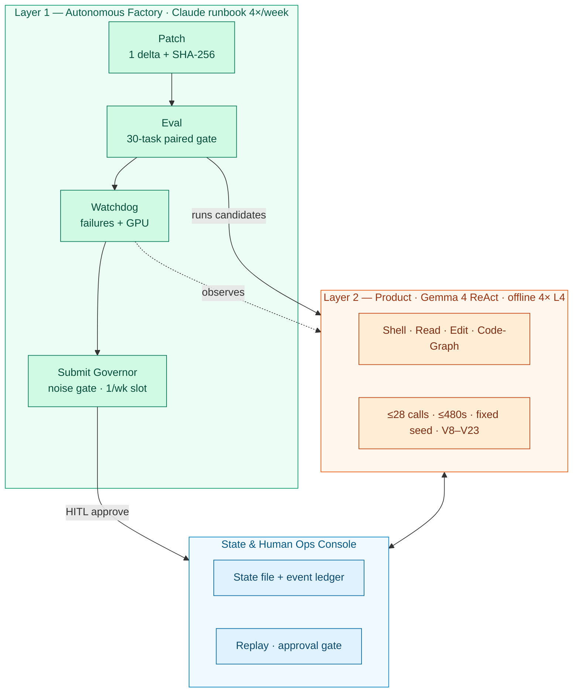

# NoiseGate Gemma 4 Factory

> Preferred viewer: this [GitHub Wiki](https://github.com/khaosans/noisegate-gemma4-factory/wiki/Home). Editors sync from in-repo `docs/wiki/`.

An autonomous **build → evaluate → submit** loop that separates real agent improvements from benchmark noise.

The public notebook that shows **0.22** scored **0.17** when we submitted it. Baseline **V8** fluctuates **8 / 6 / 8** on the same 30 tasks. One planned submit / week + ~30 GPU hours → trusting a single score burns luck.

| | |
|---|---|
| Authors | Souriya Khaosanga · Adil Shamim |
| Competition | [Gemma 4 Developer Agent](https://www.kaggle.com/competitions/gemma-4-developer-agent) · deadline 2026-12-02 |
| Best public (base) | **0.18** (V8) |
| Repo | [noisegate-gemma4-factory](https://github.com/khaosans/noisegate-gemma4-factory) |
| Video | https://youtu.be/-EiKv_MafOY |
| Ops Console (**main UI**) | [artifact](https://claude.ai/artifact/6R7YzcGjHzh3U6dreF9YsW) · docs [[Ops-Console]] |

**Score SoT:** factory base here is **V8 @ 0.18**. Sibling [`cmu-agentic-ai`](https://github.com/khaosans/cmu-agentic-ai) climb tips use `docs/scoreboard.json` (may differ, e.g. tip best **0.10**) — not the same artifact ledger.

## Architecture at a glance

Factory governance above a Gemma 4 ReAct product; humans on the Ops Console for costly steps. Console never CreateSubmission.

*Insight.* The surface that matters is the **noise gate** between Eval and Submit — gains inside V8’s ±2.5 band HOLD. [[Architecture]].

## Demo in under a minute

1. Open the [[Ops-Console]] Claude artifact (**main UI**).
2. Show a HOLD above the V8 noise band (V18 / V21 / V17).
3. Climb login path = Claude Skills — not the console for CreateSubmission.

Talk track: [[Demo-Script]].

## Pages

| Page | Purpose |
|---|---|
| [[Method-Card]] | One-page academic method (problem → gate → evidence) |
| [[Architecture]] | Figure 1 · weekly turn · noise/telemetry · HITL tiers |
| [[Ops-Console]] | **Main** Claude Agent Ops Console (screens + deny list) vs Cowork |
| [[Claude-Cowork-Loop]] | Schedule + Skills |
| [[Requirements-Compliance]] | ADK zip vs LangGraph · HITL · goldens |
| [[Future-Work]] | Next levers (hypotheses labeled) |
| [[Demo-Script]] | 3–5 min talk |

## Primary sources

| Doc | Role |
|---|---|
| [CONCEPTS.md](https://github.com/khaosans/noisegate-gemma4-factory/blob/main/CONCEPTS.md) | Concept → code |
| [factory/runbook.md](https://github.com/khaosans/noisegate-gemma4-factory/blob/main/factory/runbook.md) | Cadence + human decisions |
| [wiki Ops-Console](https://github.com/khaosans/noisegate-gemma4-factory/wiki/Ops-Console) | Main demo UI screens + deny list |
| [docs/safety-plan.md](https://github.com/khaosans/noisegate-gemma4-factory/blob/main/docs/safety-plan.md) | Safety → tests |
| [GOALS.md](https://github.com/khaosans/noisegate-gemma4-factory/blob/main/GOALS.md) | OKRs |
