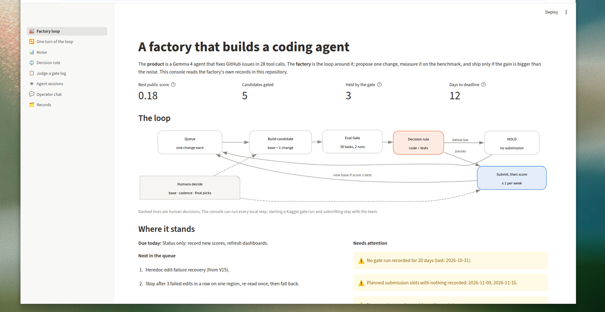

# Local path and Streamlit console (optional)

**Optional** local surface for demos and operator queries without Claude login. It does **not** replace the default [[Ops-Console]] Claude artifact for class talks, and it does **not** replace the Cowork climb loop for Kaggle auth.

**Default UI:** [[Ops-Console]] (Claude Agent Ops Console artifact).  
Related: [[Claude-Cowork-Loop]] (live climb) · [[Home]].

Full page catalog: [`docs/factory-console.md`](https://github.com/khaosans/noisegate-gemma4-factory/blob/main/docs/factory-console.md).

> **Status — optional & needs work (docs only):** Streamlit on `:8765` is **rough around the edges** and secondary to the Claude Ops Console. Prefer [[Ops-Console]] for demos. Start Streamlit only when you need live checkout files (CSV query, Approve `record_score`, pytest/zip). **Leave `factory_console/` application code untouched for now.**



## Quick start

```bash
pip install -r requirements-console.txt -r requirements-agent.txt
streamlit run factory_console/app.py --server.port 8765
# → http://127.0.0.1:8765
```

Claude Code / local launch config also pins port **8765** (`.claude/launch.json`).

## Mac KeepAlive (ops host)

On the demo Mac, LaunchAgent `com.noisegate.factory-console` can KeepAlive Streamlit via `/tmp/run-factory-console-8765.sh` (logs under `/tmp/factory-console-8765.*.log`). That plist is host ops, not committed to the repo. Classmates should use the `streamlit run … --server.port 8765` command above — or skip Streamlit and use [[Ops-Console]].

## Chat backends

On current `main`: Claude (if `ANTHROPIC_API_KEY` / token present) or **offline** keyword mode.

**[#3](https://github.com/khaosans/noisegate-gemma4-factory/pull/3) (merged)** adds Ollama:

```bash
ollama serve
ollama pull llama3.2:3b
export FACTORY_CONSOLE_BACKEND=ollama   # or auto (Claude → Ollama → offline)
export OLLAMA_HOST=http://127.0.0.1:11434
export OLLAMA_MODEL=llama3.2:3b
streamlit run factory_console/app.py --server.port 8765
```

| Backend | When | Notes |
|---|---|---|
| Claude | Anthropic credentials | Default model override: `FACTORY_CONSOLE_MODEL` |
| Ollama | #3 merged + daemon up | OpenAI-compatible `/v1/chat/completions` + tools |
| Offline | Always available | Keywords: `status`, `why V17`, `what if …`, `run tests`, … |

## Climb / Kaggle read-only bridge (#4 merged)

Requires Ollama stack from [#3](https://github.com/khaosans/noisegate-gemma4-factory/pull/3) (both on `main`).

```bash
export CMU_AGENTIC_AI_ROOT=/absolute/path/to/cmu-agentic-ai
export FACTORY_CLIMB_REFRESH=1   # optional: refresh scoreboard before snapshot
```

Tools: `climb_scoreboard`, `kaggle_submissions_snapshot`. Climb `docs/scoreboard.json` is the live **publicScore SoT** for tip packaging; NoiseGate `results/leaderboard.csv` is factory bookkeeping and may disagree (`score_mismatch`). Bridge is **read-only** — never CreateSubmission, never auto-overwrite CSV.

## What the console may do

From `factory_console/actions.py` (same functions for chat and pages):

| Group | Examples |
|---|---|
| **Query** | Gate runs, leaderboard CSV, candidates/queue, decisions, lessons, goals, log, agentops runs |
| **Check** | Runbook status, replay decision rule, what-if numbers, judge pasted gate log |
| **Run** | `pytest`, safety eval, zip build + SHA-256s, one supervised / scripted agent session |

## What it must not do

- Start a Kaggle Eval Gate run
- **CreateSubmission** (or any submit automation)
- Change the base config
- Auto-overwrite `results/` without **Approve** (`record_score` only queues)

These stay human / Cowork per the runbook.

## What is real vs stand-in

- Gate and leaderboard numbers on disk are recorded.
- “Judge a gate log” default text is a **synthetic** 8-task sample until you paste a real log.
- “Run scripted session” is **not** Gemma — it demos supervisor + guardrails.
- “Run Gemma session” needs a local tool-capable Gemma tag via Ollama (`NOISEGATE_MODEL`).
- Real Eval Gate is ~6 hours on Kaggle 4× L4; the console never runs it.
