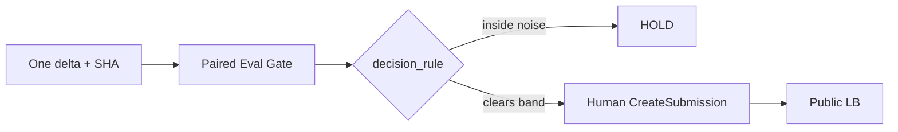

# Method card

One-page academic summary. Detail: [[Architecture]] · [[Trajectory-Eval-Rubric]] · [[Requirements-Compliance]] · [CONCEPTS.md](https://github.com/khaosans/noisegate-gemma4-factory/blob/main/CONCEPTS.md).

## Problem

Coding agents fail quietly under a **fixed** model and tool harness: plausible patches, late edits, budget overruns, and lucky leaderboard noise. Operators need a path where **success and refusal are measurable**, and promotions cost GPU + a weekly submit slot.

## Method

| Piece | Choice |
|-------|--------|
| Product | Single **Google ADK** ReAct agent on fixed `gemma-4-31b-it` (locate → edit → verify → `submit_patch`) |
| Factory | Claude scheduled runbook: **exactly one** delta off base → paired Eval Gate → coded ship rule (**loop v2** since 2026-11-20: KEPT14 + z-gate + wake ledger; **v1** was calendar + 30-task noise band — both kept visible in [[Architecture]]) |
| Default | **HOLD** when gain is inside measured noise (~±2.5 in-budget / 30; ~±0.05 public LB) |
| Submit | Human CreateSubmission; **1 / UTC day** (host); quality bars in [[Submit-Policy]]; consoles never submit |
| Course slice | LangGraph supervisor + guardrails (**not** in the Kaggle zip) |

## Core insight

**The evaluation harness matters more than the generator.** Same configs move several tasks between runs. A public 0.22 notebook scored **0.17** for us; V11 looked better locally and lost on the board. The factory’s most useful act is refusing to ship.

## Evidence (pointers)

| Claim | Where |
|-------|--------|
| V8 base public **0.18**; HOLDs V14/V16–V19/V21/V23; V20 LB 0.13; V22 confirming; V24 queued | [README results](https://github.com/khaosans/noisegate-gemma4-factory#results-that-matter-for-shipping) · `results/` |
| Noise band chart + 4-tier trajectory rubric | [[Trajectory-Eval-Rubric]] |
| Calibration: local vs LB agree/disagree | [[Architecture]] · `results/README.md` |
| Safety: 55/55 adversarial blocked, 0/29 false positives | [[Requirements-Compliance]] · `evals/safety` · `docs/safety-plan.md` |
| Concept → code map | [CONCEPTS.md](https://github.com/khaosans/noisegate-gemma4-factory/blob/main/CONCEPTS.md) |

## Score sources (do not conflate)

| Number | Meaning |
|--------|---------|
| **0.18** (V8) | Factory base — NoiseGate product / this repo’s scored base |
| Sibling climb tips in `cmu-agentic-ai` | Separate tip packaging SoT (`docs/scoreboard.json`); may show a different best tip (e.g. **0.10**) until a gated submit beats V8 |

Never invent `publicScore`. Climb bridge is **read-only**.

## What we are not claiming

- That LangGraph is the competition agent  
- That Streamlit automates CreateSubmission  
- That the gate predicts every LB point (calibration is partial)  
