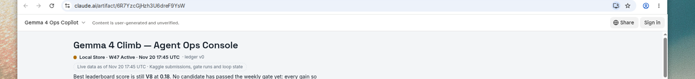
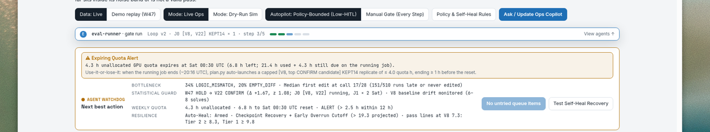
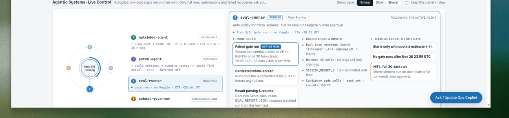
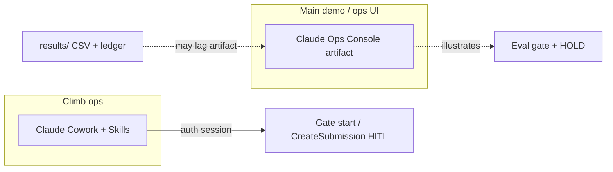

# Ops Console (Claude artifact) — main UI

**Live UI:** [claude.ai/artifact/6R7YzcGjHzh3U6dreF9YsW](https://claude.ai/artifact/6R7YzcGjHzh3U6dreF9YsW)

NoiseGate’s **main operator / demo interface**: the Claude **Agent Ops Console** artifact. Use it for class talks, portfolio demos, and the factory narrative (gate HOLD, HITL, never CreateSubmission).

It is **paper / replay** of recorded factory state — not the climb runtime and **never** CreateSubmission. Cowork remains the authenticated climb path for gate-start and human CreateSubmission.

Prefer linking out (do not iframe claude.ai in README — auth / embed fragility). Artifact URLs can drift; keep this page as the in-repo SoT for *what the Ops Console means*.

## Screens (how to read it)

### Overview

Landing view: factory status, best score / HOLD context, and the live control surface. This is the screen to open first in a demo.

### Controls

Mode toggles: **Data** (Live vs Demo replay), **Mode** (Live Ops vs Dry-Run Sim), **Autopilot** (policy-bounded vs Manual Gate), plus Ops Copilot. Demo talks stay on replay / low-HITL narrative — never invent scores.

### HOLD / gate insight

Why the factory refuses to ship: gains inside the V8 noise band **HOLD**; expensive steps need a human. Point here when explaining the eval-over-generator thesis. Quantitative band chart + scoring: [[Trajectory-Eval-Rubric]] (UI screenshot stays on this page only).

### Agents

Agentic Systems panel: watchdog / patch / eval-runner / submit-governor. Drill into the running agent for skills, bound tools, and hard guardrails (HITL on full gate runs).

## Role in the system

Two surfaces that matter for operators:

| Surface | How | Data | CreateSubmission / gate-start? |
|---------|-----|------|--------------------------------|
| **Claude Ops Console** (this page) — **main UI** | Claude artifact | Paper / **replay** of recorded runs | **No** |
| **Claude Cowork** | Project + Skills + runbook | Authenticated Kaggle session | **Human only** |

## Policy & Self-Heal panel

The artifact’s **Policy** copy mirrors climb submit-governor / `LOOP` rules: **1 CreateSubmission per UTC day**, V8-derived **5-task** bar, **7-task safety** only for tool/edit-mechanics flags, strict-win + settings transplant for external configs, and pre-flight (incl. ≤ 11.2 h). Design rationale (why those choices): [[Submit-Policy]].

## What you can show

- Factory loop story: one delta → screen / HOLD → human submit  
- Policy panel: host cadence + risk-tiered bars (not homemade weekly caps)  
- Human approval before CreateSubmission (HITL)  
- Separation of product (Gemma ReAct) vs factory governance  
- Full demo from the artifact alone (no local console required)

## What you cannot claim

- Live leaderboard scrape or invented `publicScore`  
- Starting a Kaggle Eval Gate from the artifact  
- CreateSubmission or changing the base config  
- That artifact numbers are fresher than `results/*.csv` (they may **lag**)  
- That this UI replaces Cowork for login-heavy climb work  

Scores only count when they appear in `results/` / climb SoT — never invent them from the paper UI.

## Related docs

| Concern | Docs |
|---------|------|
| Primary climb path | [[Claude-Cowork-Loop]] |
| Submit cadence + bars | [[Submit-Policy]] |
| Architecture bands | [[Architecture]] · [[Method-Card]] |
| Demo talk track | [[Demo-Script]] |

## When to open which

| Goal | Open |
|------|------|
| Class talk / portfolio / ops narrative | **Claude Ops Console** artifact (**main**) |
| Build candidate, start Eval Gate, CreateSubmission | **Cowork** (human) |

## Demo (60 seconds)

1. Open the [Ops Console artifact](https://claude.ai/artifact/6R7YzcGjHzh3U6dreF9YsW).  
2. Overview → controls → HOLD insight → agents (same order as screens above).  
3. Say: “This console never CreateSubmission — humans / Cowork own that.”

Full talk track: [[Demo-Script]].

## Maintaining the artifact

1. After meaningful `results/` or runbook changes, refresh the Claude artifact (or note lag on this page).  
2. Update this wiki page if the **role** or deny-list changes — not for every cosmetic UI tweak.  
3. After merging docs to `main`, sync GitHub Wiki from `docs/wiki/` (include `assets/ops-console/` PNGs with the markdown).  
4. Optional later: archive a static export under `docs/ops-console/` if the claude.ai URL breaks (out of scope for this pass).

## Security / trust

See [`SECURITY.md`](https://github.com/khaosans/noisegate-gemma4-factory/blob/main/SECURITY.md). Artifact = demo-only; no secrets in screenshots or pasted logs.
