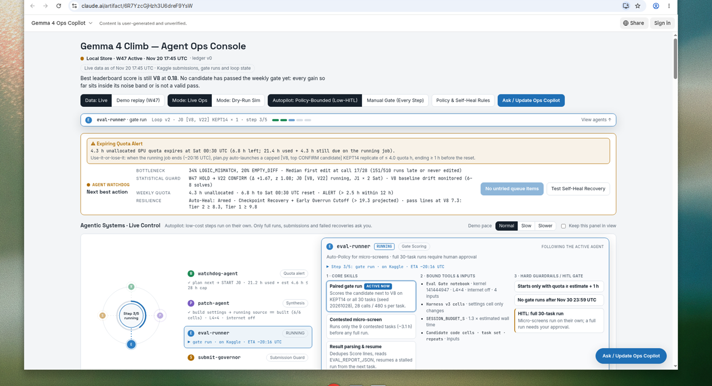
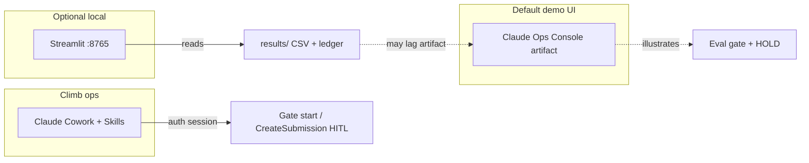
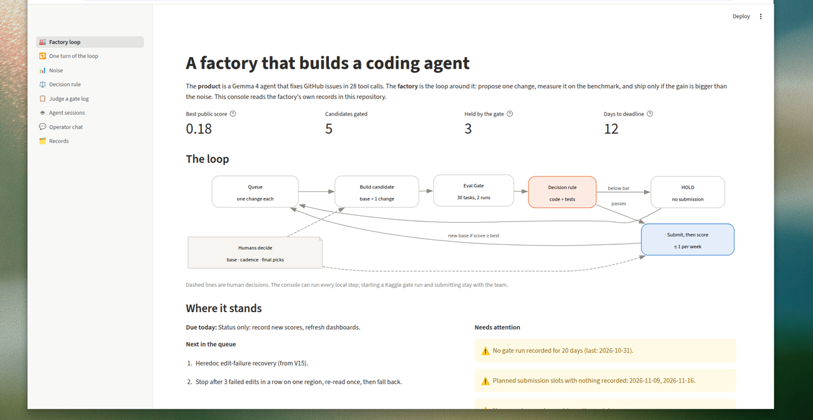

# Ops Console (Claude artifact) — default UI

**Live UI (default):** [claude.ai/artifact/6R7YzcGjHzh3U6dreF9YsW](https://claude.ai/artifact/6R7YzcGjHzh3U6dreF9YsW)

This is NoiseGate’s **default operator / demo interface**: the Claude **Agent Ops Console** artifact. Use it for class talks, portfolio demos, and the factory narrative (gate HOLD, HITL, never CreateSubmission).

It is **paper / replay** of recorded factory state — not the climb runtime and **never** CreateSubmission. Streamlit `:8765` is an **optional** local adjunct when you need live `results/` on disk. Cowork remains the authenticated climb path.

Prefer linking out (do not iframe claude.ai in README — auth / embed fragility). Artifact URLs can drift; keep this page as the in-repo SoT for *what the Ops Console means*.

## Role in the system

Three operator surfaces — **default first**:

| Priority | Surface | How | Data | CreateSubmission / gate-start? |
|----------|---------|-----|------|--------------------------------|
| **Default** | **Claude Ops Console** (this page) | Claude artifact | Paper / **replay** of recorded runs | **No** |
| Optional | **Streamlit** | `streamlit run factory_console/app.py --server.port 8765` | Live repo `results/` (+ optional climb **read-only** bridge) | **No** |
| Climb | **Claude Cowork** | Project + Skills + runbook | Authenticated Kaggle session | **Human only** |

> **Default vs optional:** open the Claude Ops Console artifact for demos and the ops story. Streamlit is optional, rough, and only worth starting when you need local CSV / Approve / pytest against the checkout. **No Streamlit application code changes in this docs pass** — leave `factory_console/` alone. Details: [[Local-And-Streamlit]].

## What you can show

- Factory loop story: one delta → paired gate → **HOLD** inside noise  
- Human approval before costly ledger writes (HITL narrative)  
- Separation of product (Gemma ReAct) vs factory governance  
- Full demo without installing Streamlit

## What you cannot claim

- Live leaderboard scrape or invented `publicScore`  
- Starting a Kaggle Eval Gate from the artifact  
- CreateSubmission or changing the base config  
- That artifact numbers are fresher than `results/*.csv` (they may **lag**)  
- That this UI replaces Cowork for login-heavy climb work  

Scores only count when they appear in `results/` / climb SoT — never invent them from the paper UI.

## Optional: in-repo Streamlit console

| Concern | Docs |
|---------|------|
| Pages, chat backends, Approve flow | [`docs/factory-console.md`](https://github.com/khaosans/noisegate-gemma4-factory/blob/main/docs/factory-console.md) |
| May / must-not + climb bridge | [[Local-And-Streamlit]] |
| Primary climb path | [[Claude-Cowork-Loop]] |
| Architecture bands | [[Architecture]] · [[Method-Card]] |

Streamlit mirrors the same factory concepts for **local** query/replay. Same deny list: no gate-start, no submit. Treat it as optional until polished.

## When to open which (operator cheat sheet)

| Goal | Open |
|------|------|
| Class talk / portfolio / default demo | **Claude Ops Console** artifact (**default**) |
| Live CSVs, replay `decide()`, Approve `record_score`, pytest/zip | **Streamlit** `:8765` (**optional**, rough) |
| Build candidate, start Eval Gate, CreateSubmission | **Cowork** (human) |

## Demo (60 seconds)

1. Open the [Ops Console artifact](https://claude.ai/artifact/6R7YzcGjHzh3U6dreF9YsW) — **this is the default demo**.  
2. Point at factory loop / a HOLD above the V8 noise band.  
3. Say: “Consoles never CreateSubmission — humans / Cowork own that.”  
4. Optional only: Streamlit for “same story, live files on disk.”

Full talk track: [[Demo-Script]].

## Maintaining the artifact

1. After meaningful `results/` or runbook changes, refresh the Claude artifact (or note lag on this page).  
2. Update this wiki page if the **role** or deny-list changes — not for every cosmetic UI tweak.  
3. After merging docs to `main`, sync GitHub Wiki from `docs/wiki/` (include `assets/ops-console/` PNGs with the markdown).  
4. Optional later: archive a static export under `docs/ops-console/` if the claude.ai URL breaks (out of scope for this pass).

## Security / trust

See [`SECURITY.md`](https://github.com/khaosans/noisegate-gemma4-factory/blob/main/SECURITY.md). Artifact = demo-only; no secrets in screenshots or pasted logs.
