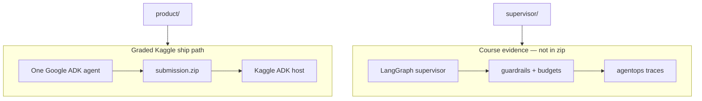
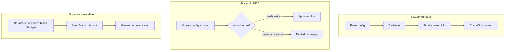

# Requirements compliance

How this repo meets course and competition expectations without pasting proprietary syllabus text. Authoritative concept → code table: [CONCEPTS.md](https://github.com/khaosans/noisegate-gemma4-factory/blob/main/CONCEPTS.md). Safety commitments: [docs/safety-plan.md](https://github.com/khaosans/noisegate-gemma4-factory/blob/main/docs/safety-plan.md). Architecture story: [[Architecture]].

## Course concepts → evidence (summary)

| Concept | Where | What it shows |
|---|---|---|
| Agent loop / ReAct | `product/superagent/prompts/system.md` | Locate → edit → verify → submit under call budget |
| Tool / ACI design | `product/candidates.md` (V16), `docs/decisions/006` | Unused tools removed; net change inside noise |
| Planning under budget | Call plan + 28-call / ~8 min caps | Late edits → EMPTY_DIFF |
| Context / sampling | `configs/sampling.yaml` | Thinking-budget cuts scored worse than V8 |
| Skills / procedures | `factory/skills/` | Loadable climb procedures |
| Persistent memory | `results/` | State survives between wakes |
| Trajectory evaluation | `harness/trajectory.py`, `evaluators.py` | E1–E4 gate; E5–E9 diagnose |
| Statistical rigor | `harness/decision_rule.py`, decision 005 | Two runs + paired net; noise band |
| Runtime guardrails | `guardrails/`, `supervisor/graph.py` | Adversarial block rate in `evals/safety` |
| Observability | `agentops/`, `docs/agentops.md` | JSONL + checkpoint metrics |
| HITL (factory) | `factory/runbook.md`, decision 004 | Humans own base, cadence, final picks, submit |
| HITL (agent) | `supervisor` `escalate` node | Interrupt on boundary / repeated blocks / high-impact |
| Self-improving systems | `factory/` | Proposes and tests; ships only above noise |
| Multi-agent supervisor | `supervisor/` (LangGraph) | Course evidence; **not** in Kaggle zip |

## Competition constraints (reflected in process)

- Fixed model: `gemma-4-31b-it` — no weight swaps in the graded agent.
- One submission per UTC day; scoring ~1.5 days; factory self-limits to ≤1 gated submit / ISO week.
- Candidates are base + **exactly one** change; zip SHA-256 verified before gate trust.
- No competition data, weights, or credentials in the repo.
- Graded ship path: **ADK SuperAgent zip** built by `product/build_submission.py`.

## ADK zip vs LangGraph supervisor

| | Competition submission | Course / safety slice |
|---|---|---|
| Runtime | Kaggle ADK agent | Local LangGraph supervisor |
| Path | `product/` | `supervisor/` + `guardrails/` + `agentops/` |
| Purpose | Leaderboard score | Budgets, tool policy, escalate, traces |
| In zip? | Yes | No |

*Insight.* Graders should score the **ADK zip** for competition competence. LangGraph is deliberate course evidence (budgets, tool policy, escalate) — Decision 007 keeps it out of the ship contract so the two surfaces stay honest.

## HITL summary

| Surface | Human required for |
|---|---|
| Factory runbook | Base, cadence, final two private selections, CreateSubmission |
| Streamlit console | Approve before `record_score` writes; never gate-start / submit |
| Supervisor | Escalate interrupts on boundary / failing or high-impact patches |

*Insight — HITL tiers.* Autonomy stops where cost or irreversibility starts: full gates and CreateSubmission need a person; the console can propose ledger writes but cannot submit. Supervisor interrupts are local course safety, not the Kaggle host.

## What we are not claiming

- That LangGraph is the competition agent.
- That Streamlit automates Kaggle submit.
- That local Ollama chat (merged #3) replaces Cowork for climb ops.
- That gate and public leaderboard always agree (calibration is partial; see Future work).
