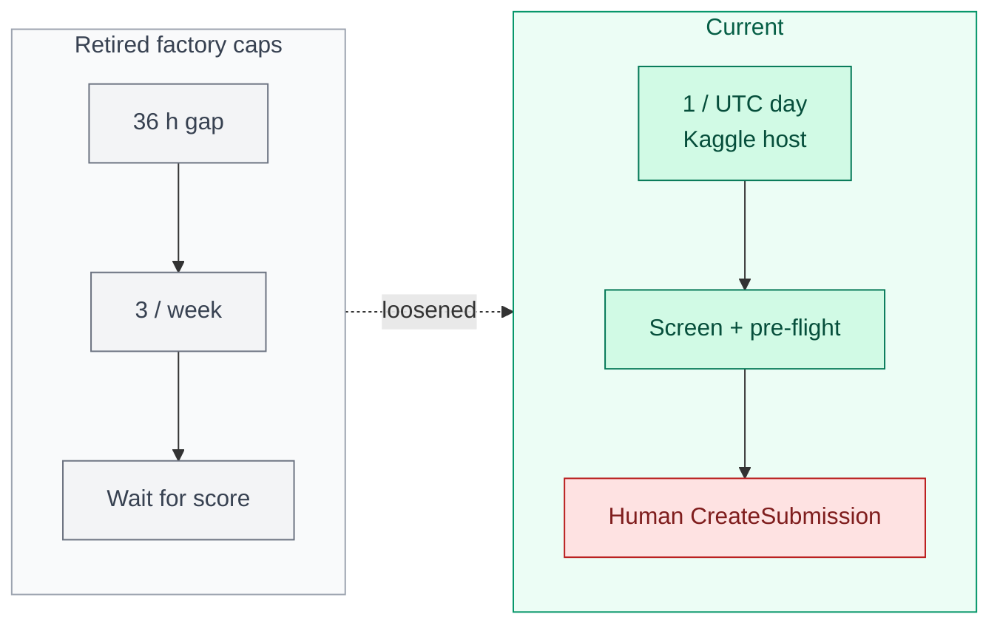
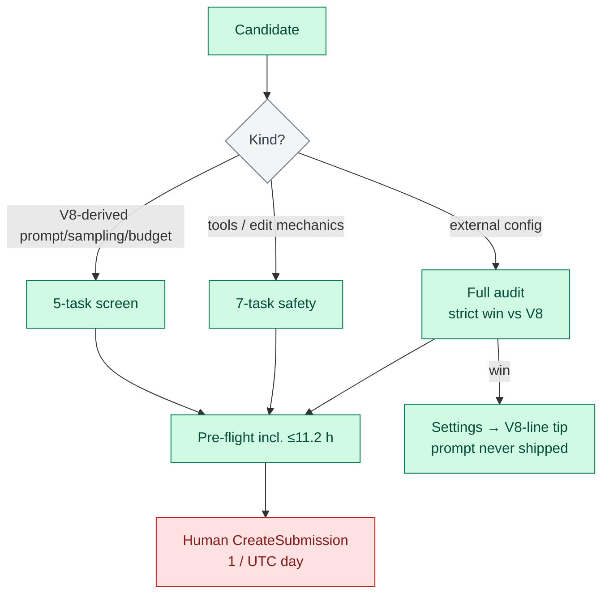

# Submit policy

How NoiseGate decides **whether a candidate may use a Kaggle CreateSubmission slot**. Consoles never submit; a human still clicks CreateSubmission on Cowork.

Live controls also appear on the Ops Console **Policy & Self-Heal** panel and in the climb `LOOP` / submit-governor copy. This page is the in-repo SoT for *why* the rules look the way they do.

## Design intent

| Principle | Practice |
|---|---|
| Host limits are hard | Respect Kaggle’s **1 submission per UTC day**. Do not invent stricter factory caps that idle the slot. |
| Quality before speed | A short, reproducible screen (and pre-flight) still gates every upload. |
| Risk-tier the bar | Prompt / sampling / budget deltas off **V8** are cheaper to trust than tool-definition or foreign-config imports. |
| One mechanism per ship | Settings can be promoted; a foreign **prompt** is never submitted as-is. |
| Humans own irreversibility | CreateSubmission stays HITL. |

## Cadence (current)

**Limit:** 1 CreateSubmission per **UTC day** (Kaggle).

**Retired factory caps** (removed so learning is not stalled by our own rules):

- Fixed ~36 h gap between submits  
- Cap of 3 submits / week  
- Blocking the next slot until the previous submission finishes scoring  

Scoring still takes ~1.5 days on the host; that is observation lag, not a factory lockout.

*Insight.* We still refuse luck with **evaluation bars**; we no longer refuse calendar with homemade cadence.

## Promotion bars

### A — V8-derived (prompt / sampling / budget)

Candidates that change prompt, sampling, or budget off the V8 line may submit after a **5-task screen** (no automatic 7-task safety run).

**Pass when all hold:**

1. At least **tie** V8 on the screen  
2. Solve **`requests_7328`**, and **`rich_3521` or `fastapi_5624`**  
3. First edit **earlier than V8**  
4. **Zero** malformed tool calls and **no** test edits  

Examples in queue: Q28–Q30, Q32, Q27, Q34.

### B — Tool or edit-mechanics changes

If a candidate is flagged as changing **tool definitions** or **file-editing mechanics**, run the **7-task safety** check first. Unflagged prompt/sampling/budget items skip it (frees ~1 GPU-h when the queue has no such flags).

### C — External configs (e.g. public notebooks)

Full audit. Must **strictly beat** V8 (a tie is not enough). On a win, **settings** may be transplanted into a V8-line candidate (e.g. Q34); the external **prompt is never submitted**.

### Pre-flight (every submission)

All of the above still require pre-flight, including the **12-hour** wall estimate (**≤ 11.2 h**). Proposals skip candidates that have not cleared it; pre-approved uploads wait until they do.

## Why these choices

| Choice | Rationale |
|---|---|
| Drop 36 h / 3-per-week / wait-for-score | Those caps were **stricter than Kaggle** and delayed feedback without adding signal. |
| Keep 5-task bar for V8-line | Cheap smoke that still demands early edit + named regressions vs V8. |
| Safety 7 only when tools/edit change | Tool ACI changes are higher blast radius; prompt tweaks are not. |
| Strict win for external configs | Imports can look strong locally and fail on the board (V15 lesson); require a clear beat before transplanting settings. |
| Pre-flight ≤ 11.2 h | Protects weekly GPU quota from runaway screens. |

## Related

- Climb path: [[Claude-Cowork-Loop]]  
- Bands / harness: [[Architecture]]  
- Ops UI (Policy panel): [[Ops-Console]]  
- Runbook: [`factory/runbook.md`](https://github.com/khaosans/noisegate-gemma4-factory/blob/main/factory/runbook.md)
