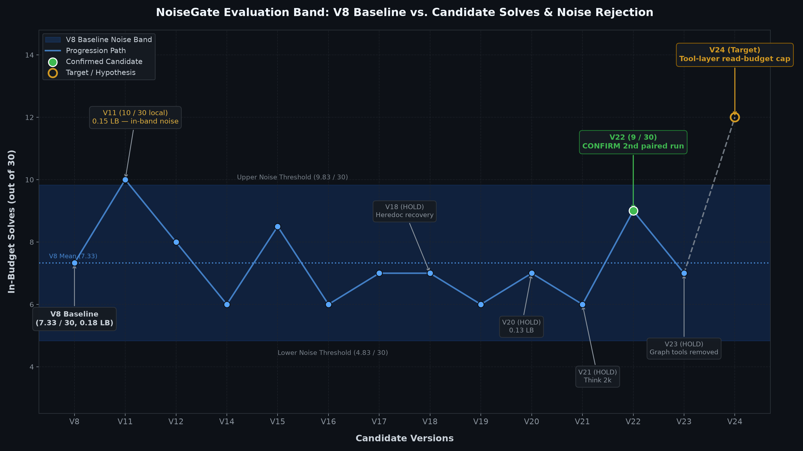

# Trajectory Eval Rubric

Preferred wiki viewer for the gate noise-band chart and trajectory scoring. Editor SoT for the full field map: [`docs/TRAJECTORY_RUBRIC.md`](https://github.com/khaosans/noisegate-gemma4-factory/blob/main/docs/TRAJECTORY_RUBRIC.md). Chart generator: [`harness/plot_gate_band.py`](https://github.com/khaosans/noisegate-gemma4-factory/blob/main/harness/plot_gate_band.py).

## NoiseGate Evaluation Band



**NoiseGate Evaluation Band.** Evaluated candidate pass rates against the empirical V8 baseline noise band (**7.33 ± 2.5** in-budget solves out of 30 tasks). Because single-run stochastic variance spans about **±2.5** solves, any candidate landing within this band (such as V14, V16–V21, and V23) reflects measurement noise rather than structural capability gains and is strictly **HOLD**.

Related: [[Architecture#figure-2--noise-band-and-telemetry]] · [[Submit-Policy]] · [[Method-Card]].

## 4-tier scoring (summary)

Each of the 30 gate tasks is scored on four axes:

| Axis | Exemplary | Passing | Degraded (HOLD) | Failed (REJECT) |
|---|---|---|---|---|
| **Recon Efficiency** | `first_edit ≤ 8` | `9–14` | `≥ 15` read-loop stall | `≥ 28` or never edits |
| **Patch Hygiene** | Clean diff early; zero malformed | Valid patch; 1–2 recoveries | Late best-guess fallback | Empty / malformed / test-file edit |
| **Verification** | Targeted repro mid-budget | Clean exit before ceilings | Late or skipped verify | Overruns 28 calls / 480s |
| **Paired Net Signal** | `paired_net ≥ +3` | `≥ +1` | `≤ 0` in-band | `< -1` regression |

Full cell text and harness field mapping: [TRAJECTORY_RUBRIC.md](https://github.com/khaosans/noisegate-gemma4-factory/blob/main/docs/TRAJECTORY_RUBRIC.md).

## Failure taxonomy (V8–V23)

| Mode | What we saw | Next lever |
|---|---|---|
| **Read-loop overrun** | Median first edit at call 16/28; 62.3% overruns (N=390) | V24 tool-layer read-budget cap (queued) |
| **Empty / malformed diff** | High empty-run counts on V8/V16–V18 | V18 heredoc recovery · V22 best-guess |
| **In-band noise luck** | Local spikes that vanish on LB (~±0.05 board noise) | Paired runs + z-gate before spending the UTC-day slot |

## How to score a gate log

```python
from harness.trajectory import parse_log
from harness.decision_rule import decide, paired_net

results = parse_log(open("eval_output.log"))
```

Core metric: `in_budget_solve` = solved within **28** calls and **480s**. Promotion still requires non-negative `paired_net` vs V8 and the [[Submit-Policy]] bars.
