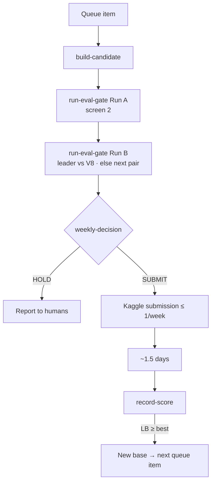

# Factory: the loop that builds, judges, and ships the product

Claude runs the climb loop inside a claude.ai Project on scheduled wakes. It proposes candidates,
builds them on Kaggle, runs the Eval Gate, applies the decision rule, and submits at most once a week.
Humans set the base, the cadence, and the final selections.

Diagram story (Figure 1 three-band + weekly turn): [Architecture wiki](https://github.com/khaosans/noisegate-gemma4-factory/wiki/Architecture) · [Claude Cowork Loop](https://github.com/khaosans/noisegate-gemma4-factory/wiki/Claude-Cowork-Loop).

*Insight.* Run A screens; Run B only spends a full paired comparison when a leader clears V8 — or screens the next pair if both trail V8’s mean (`runbook.md`). HOLD is a successful outcome when the gain is inside noise.

| Piece | File |
|---|---|
| System prompt for the Project | `project-instructions.md` |
| Operating procedure, cadence, guardrails | `runbook.md` |
| Procedures as loadable skills | `skills/*/SKILL.md` |
| Persistent memory | `../results/eval-results.md`, `../results/*.csv` |
| Decision logic as code | `../harness/decision_rule.py` |
